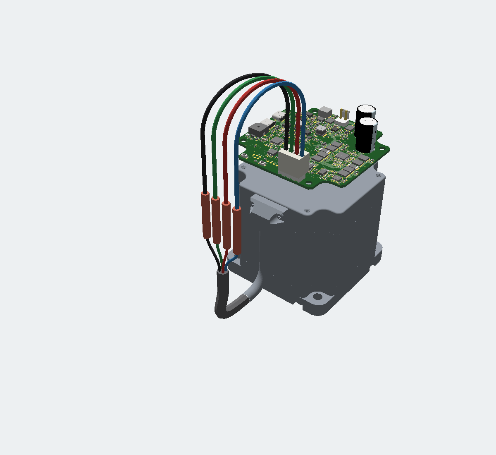
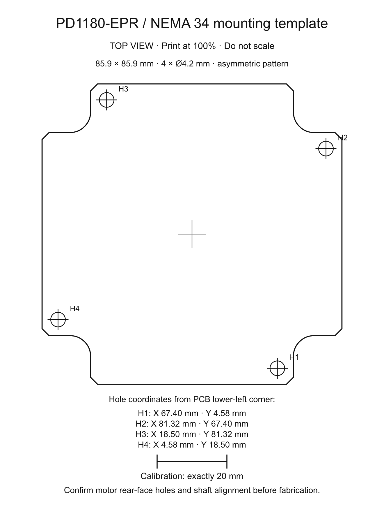

# PD1180-EPR — NEMA 34 Smart Motor-Mounted Stepper Controller with USB-C PD 3.1 EPR

Component names come from native footprint references, including SW1 and SW2; custom imports use `{NAME}`. Q5, L3, R4, C92, C89 and R9 use inward reference anchors to keep their names inside the board. No names are hidden or replaced with detached captions. [Edge labels before](previews/edge-labels-before.png) · [Edge labels after](previews/edge-labels-after.png). The earlier pre-label screenshot is preserved byte-for-byte in [native-reference history](previews/native-reference-history.zip).

**Current protection and label revision:** unused U1 SBU wiring is corrected in source/native copper and a reviewed TI full-flash candidate is included. All native references remain visible and inside the outline. Native DRC retains 401 silkscreen/text findings, with zero unconnected items, parity issues and ERC violations. Review archives include these findings; fabrication and motor operation remain held. See [completion and acceptance](docs/completion-handoff.md), [readiness](docs/readiness.md) and [PD review](docs/pd-configuration-review.md).


PD1180-EPR is an 85.9 × 85.9 mm, four-layer controller for the ordered STEPPERONLINE 34HS31-6004S1 NEMA 34 motor (Amazon ASIN B091C83HWF). Its rated holding torque is 4.8 Nm and rated current is 6 A/phase; the driver RMS/hold-current setting and driven load remain unqualified. J1 is the dedicated 48 V / 5 A USB Power Delivery 3.1 EPR input; J10 is a separate USB 2.0 device-data port. The board combines protected power entry, a TMC5160A external-MOSFET motor stage, STM32G0B1 control, an optional DNP magnetic encoder footprint and local START/STOP control.

**Power/thermal ECO — 2026-10-13:** TPS26630 1× current limiting at nominal 3.61 A, 53.21 V motor inhibit, D20 brake-cable flyback clamp, and ADS1115 brake continuity preflight added. The firmware ceiling is 3.8 A RMS with a locked 0.827 A / 10 rpm unloaded commissioning profile. PR #2 adds current-request guards and expanded tolerance/fault checks while preserving the main ECO. See [calculations and simulation limits](docs/power-validation.md).

**Previous control ECO — 2026-10-12:** J7 and 33 associated command/interface parts removed from TSX; SW2 START/STOP and R133 added. STM32 now commands the TMC5160 internal SPI ramp. SW1 RESET, J2 VH, both USB ports and protection remain. Removed 51 unsupported mounting parts; kept all four Ø4.2 mm holes unchanged. [Before](previews/onboard-control-before.png) · [After — source alignment preview](previews/onboard-control-after.png).

**Status:** source, firmware, native PCB and 3D updated. Electrical connectivity, schematic parity and ERC pass; 401 user-accepted cosmetic DRC findings remain in the raw report. Motion and ordering remain locked; live sourcing and powered/mechanical qualification are open.

**Reference review is still open:** [Line-by-line response and full comparison](docs/reference-review.md) records the added RGB, buzzer, independent power indication, dedicated probes and EEPROM isolation, plus unresolved programming/cable/fixture qualification. The feature-presence check is not a complete-parity claim.

**Sourcing/programming hold:** exact fitted-part availability has not passed the repository review/order gate. TI full-flash programming, powered bridge/current/thermal tests and mechanical fastening remain unverified. No hardware operation is claimed.

[View the board on tscircuit](https://tscircuit.com/techmannih/NEMA-34-Smart-Motor-Mounted-Stepper-Controller) · [Open the manufacturing release](release/) · [Read the reviewer checklist](docs/reviewer-checklist.md)

Open `motor-assembly.circuit.tsx` for the current 54-part assembly: ordered motor, retained J2 harness, J3 mating plug/contacts, two cables, resistor terminals, Vishay LPS300 resistor and provisional cooling/guard installation. U18 alone is on the bottom; C52/C53 are on top, with all three remaining DNP. The [J3 assembly guide](docs/brake-assembly.md) lists parts, wiring, cable lengths and qualification limits. No replacement motor mounting hardware was introduced. The routed viewer and review archives retain the native findings.



## What must arrive with the assembled board

The intended purchase is **PCB fabrication plus complete assembly, programming and functional test**, so the delivered PCBA can operate with its specified motor, power source and harness. Bare-PCB electrical testing and soldering the components do not establish motor operation. Programming and powered testing must be explicitly included in the accepted assembly/test work order; they are not assumed to be included in an SMT assembly quote.

**The current release cannot yet deliver a ready-to-run motor controller.** No assembled hardware has been tested. U3's register-reviewed TI PD image is generated but not programmed/read back, and the supplied STM32 commissioning image deliberately blocks motor power and motion, including after `ARM`. The following deliverables are required before accepting a board as ready to run:

| Deliverable | Required handoff / present status |
|---|---|
| Complete populated PCBA | Matching Gerbers, BOM and CPL; 255 fitted parts on top, including an agreed through-hole/tall-part assembly plan. Source and native route built; sourcing, physical assembly and qualification pending. |
| U3 PD-controller EEPROM | Approved TI-generated TPS26750 full-flash binary, SHA-256 and programming/readback record. **Candidate binary included; physical readback pending.** See `pd1180-ti-configuration.zip`; JSON is not firmware. |
| U16 STM32 firmware | Board-specific, motor-enabled firmware with a recorded hash and validated motor/current settings. **Only motion-locked commissioning firmware is supplied today.** |
| Functional acceptance | Board serial number, firmware/configuration hashes and measured rail, PD, motor, fault and thermal results. **All powered results pending.** |
| External system | Confirmed motor, EPR source/cable, mating harnesses, brake resistor/heatsink, magnet and mounting hardware; these are outside the populated-PCB BOM. |

First articles need staged engineering qualification using [the power-validation test matrix](docs/power-validation.md), followed by an agreed per-board acceptance test for the assembled batch. If the assembler does not provide programming or motor testing, arrange a separate commissioning provider before calling the delivery ready to run. The manufacturing request and pending programming fields are in [order-settings.json](release/order-settings.json); detailed acceptance requirements are in [assembly.md](docs/assembly.md).

The [provider request and first-article programming sequence](docs/assembly.md#request-to-send-to-the-assemblytest-provider) are ready for review. Provider acceptance and the [motor/load qualification inputs](docs/power-validation.md#qualification-work-sheet-for-the-provider) remain open. Programming and the accepted motor tests must finish before shipment.

The [readback verification command](docs/pd-programming.md#save-and-verify-programming-readback) compares each board's U3/U16 dump with the registered image and saves serial-numbered evidence. It does not unlock motion or replace a powered test. The [unused-SBU correction](docs/pd-configuration-review.md) is applied and native-checked, with physical startup/fault validation pending.

## Connections and operation

The selected control path is **SW2 → STM32 → SPI → TMC5160 internal ramp → external bridges → J2 → motor**. No external controller, STEP/DIR/ENABLE cable or home/limit harness is included. J10 provides programming-provider diagnostics/setup access, not motor power. The firmware implements a bounded bench motion path but ships with all three qualification flags false; the supplied binary cannot spin the motor.

Make motor/brake/harness connections with power removed and the bus discharged. Identify each motor winding from its verified pinout or a resistance measurement; wire colours are not a pinout.

| Connection | Wiring |
|---|---|
| J1 **PD POWER** | Source explicitly supporting a 48 V / 5 A EPR contract, with a suitable 5 A EPR cable. A USB-C connector alone does not establish this capability. |
| J10 **USB DATA** | USB data cable to the setup/diagnostics host. Its independent 5 V input supplies MCU logic, not VMOTOR. |
| J2 **MOTOR** | Pin 1 A1, pin 2 A2 (one winding); pin 3 B1, pin 4 B2 (the other winding). Never connect/disconnect the motor while powered. |
| J3 **BRAKE** | The selected resistor connects between pin 1 VMOTOR and pin 2 switched BRAKE_RETURN. Pin 2 is not a permanent ground. Heatsink and installation are not yet qualified; see [brake integration](docs/brake-integration.md). |

Use the physical pin-1 marker and numbered footprint. SW2 is a functional START/STOP button; SW1 is MCU RESET. It is not a safety-rated emergency-stop implementation.

### First start with the supplied commissioning firmware

1. Complete the unpowered inspection in [bring-up.md](docs/bring-up.md). Keep J1 and the motor disconnected for the initial J10 diagnostic check.
2. If U16 has not been programmed, use ST-LINK/SWD with SWDIO, SWCLK, NRST, GND and the board's 3.3 V reference. Program the verified `firmware.bin` from [the commissioning archive](release/pd1180-commissioning-firmware.zip) at `0x08000000`, verify and reset. Follow [firmware/README.md](firmware/README.md) for the exact MCU and power arrangement. This binary belongs in U16, not U3.
3. Connect J10 and open its USB CDC serial port. Send `HELP`, `STATUS`, `DRIVER` or `DISARM`, each followed by a newline. With J10 alone, `BOARD_OK=0` is expected because the PD-powered peripherals are off; `RUN=0` and `BRINGUP_REQUIRED=1` must remain set as shown.
4. `ARM` currently returns `BLOCKED: use local START/STOP; hardware qualification required`. This is expected, not a wiring workaround. Do not bypass the lock or bridge an enable signal to make the motor run.
5. Commission U3 and the J1 power path with the approved TI image and instrumented, staged tests before connecting a motor. Then qualify a motor-enabled STM32 release, initially below 1 A RMS and only increasing current after gate, current and thermal measurements pass. **This qualification has not happened yet.**

### Normal use after the motor-enabled release is qualified

After the TI image, native PCB, gate waveforms, current and unloaded motor have been qualified: connect the motor/brake and approved EPR source while unpowered, power up, and release then press SW2. The initial bounded profile is approximately 10 rpm at approximately 0.827 A RMS; neither figure is a qualified final motor setting. Press SW2 again to request deceleration to zero before enable is removed. Faults require acknowledgement and a separate start press. Reset, power loss and USB suspend/detach cancel motion without automatic restart. See [firmware implementation and tests](firmware/README.md).

## Feature overview

| Area | Implementation |
|---|---|
| USB-C power | TPS26750 sink-only USB PD 3.1 EPR controller requesting 48 V / 5 A |
| USB ports | J1 PD POWER and J10 USB DATA; separate VBUS rails |
| USB protection | TPD4S480 on PD CC/SBU; USBLC6-4SC6 on DATA D+/D−/CC, independent 5.1 kΩ CC pulldowns and DATA VBUS sensing |
| Input protection | TPS26630 eFuse, inrush control, voltage qualification, current limit and reverse-current blocking |
| Motor stage | TMC5160A with eight 100 V CSD19534Q5A MOSFETs and two 33 mΩ phase shunts |
| Ordered motor | STEPPERONLINE 34HS31-6004S1, 4.8 Nm, 6 A/phase; approved driver current setting pending |
| Controller | STM32G0B1CEU6 with USB device, CAN, SPI, I²C and serial peripherals |
| Position feedback | Optional bottom-side AS5047P at the shaft axis (DNP), with top ABI test access |
| Temperature/current diagnostics | TMP102 hardware inhibit; two INA240 phase monitors; ADS1115 bus monitors |
| Local controls | SW2 START/STOP, SW1 RESET; no external command cable |
| Communications | USB 2.0 commissioning/diagnostics; industrial buses removed |
| Inhibit | Power, voltage, temperature and MCU interlocks |
| Braking | External switched brake-resistor interface with independent overvoltage shutdown |
| Programming | STM32 SWD; isolated U3 EEPROM I2Cc fixture access |
| Indicators | RGB status, independent board-power LED and reset-safe driven buzzer |
| Assembly | 255 supplier-coded fitted parts plus 19 service test pads, all on top |

The board powers up inhibited. A valid EPR contract, eFuse status, motor-power-good signal, voltage window, temperature and MCU request must all agree before the bridge can run. Reset defaults keep `POWER_PERMIT`, `MCU_RUN` and standalone-mode selection inactive.

## Power architecture

```text
J1 PD POWER VBUS -> reverse blocking / eFuse -> VMOTOR -> bridge power / TMC5160 VS
        |                                       |       motor J2 / brake J3
        |                                       +-> U34 12 V -> TMC5160 VSA/12VOUT
        +-> U5 3.3 V startup supply              +-> U22 3.3 V brake-control backup
                         U23 / U24 reverse-blocked OR -> V3V3
J1 CC1/2 -> U1 protection -> U2 TPS26750 EPR controller
J10 USB DATA D+/D- -> D15 shunt ESD -> R71/R72 -> STM32 USB
J10 VBUS -> U28 current limiter -> U25 LDO -> V3V3_USB
board V3V3 / V3V3_USB -> U26 / U27 reverse-blocked OR -> V3V3_MCU
```

DATA alone powers MCU setup/diagnostics on V3V3_MCU. Flash, encoder and sensors remain on board V3V3 supplied by J1/VMOTOR. Open-drain chip selects and inactive peripheral pins prevent MCU-driven backfeed. Firmware now implements USB suspend with STOP0, watchdog wake and fresh power/sensor qualification after resume; measured current, inrush, wake timing and source handovers remain unverified. U22 retains VMOTOR-fed brake control. The commissioning image keeps the motor locked.

The requested contract is 240 W. TPS26630 with R25 = 4.99 kΩ limits motor-path input to about 3.607 A nominal (173 W at 48 V before losses); MODE is open for 1× limiting and latch-off. The conservative current screen is 4.002 A plus a 250 mA upstream allocation, leaving about 0.748 A within the 5 A contract. These are screening assumptions, not guaranteed current limits. The design ceiling remains 3.8 A RMS (GS=139); the firmware additionally rejects requests above its 240-permille commissioning limit, IRUN=6 and approximately 0.827 A RMS. All three qualification locks remain false.

The 940 µF motor bulk bank stores only about 0.190 J between 48 V and the revised nominal 52.04 V brake turn-on threshold. It cannot absorb sustained regeneration. J3 connects a separately selected braking resistor and heatsink; 10 Ω / 300 W is an initial engineering target, not a validated load rating. Actual speed, attached inertia, stopping time and duty cycle determine the final resistor and thermal design. U34 now supplies the driver separately at nominal 12 V; see [the power ECO calculations and remaining tests](docs/power-validation.md).

Detailed calculations, tolerances and protection behavior are recorded in [docs/design.md](docs/design.md). The separate CC, USB-data and current-monitor paths are traced pin by pin in [docs/usb-pd-architecture.md](docs/usb-pd-architecture.md).

## Motor control and feedback

The TMC5160A controls two external MOSFET bridges. Four bootstrap capacitors, charge-pump support, gate resistors, local driver rails and two 3 W current shunts are represented explicitly. Native SPI ramp control uses grounded unused reference/encoder inputs and SD_MODE low. Motion stays inhibited until native PCB and powered validation pass.

The optional bottom-side AS5047P shares SPI with the motor driver and external flash, using an independent chip-select. Its ABI outputs are available on five top service pads for probing. The ordered motor is single-shaft, and its CAD does not identify an accessible rotating rear shaft or an approved magnet attachment. The previous QSH-specific holder and magnet stack have been withdrawn; encoder attachment, field, retention and working gap remain unresolved; see [motor assembly](docs/motor-assembly.md).

Firmware must configure current scaling, gate drive, dead time, chopper behavior, motion limits and encoder calibration for the actual motor. A register default is not an approved motor operating point.

## Interfaces

| Connector | Function | Pins / notes |
|---|---|---|
| J1 | PD POWER | 48 V / 5 A requested EPR contract; CC/SBU protection; no data connection |
| J10 | USB DATA | USB 2.0 D+/D−, independent CC pulldowns, ESD and VBUS attach sense |
| J2 | Motor | A1, A2, B1, B2; [JST VH selection and mating harness](#motor-connector-and-optional-encoder-review) |
| J3 | External brake | VMOTOR and switched resistor return |

J7 is removed. SWD/reset and optional encoder probe access remain on top service pads.

## Firmware contract

The generated STM32 pin contract lives in [docs/firmware-pinmap.json](docs/firmware-pinmap.json) and [firmware/include/board_pins.h](firmware/include/board_pins.h). The shared safety logic has host tests; the pinned PlatformIO target builds a flashable USB commissioning image with motor outputs locked pending the ECO validation. See [firmware build/programming instructions](firmware/README.md).

| Function | MCU signals |
|---|---|
| Motor SPI | `TMC_CS_N`, `SPI_SCK`, `SPI_MISO`, `SPI_MOSI`, `TMC_DIAG0`, `TMC_DIAG1` |
| Encoder/flash | `ENC_CS_N`, `FLASH_CS_N` on the shared SPI bus |
| USB | `USB_VBUS_SENSE`, `USB_DM`, `USB_DP` |
| Power safety | `BOARD_POWER_SENSE`, `EFUSE_FAULT_N`, `MOTOR_PG`, `VMOTOR_OK`, `POWER_PERMIT`, `MCU_RUN` |
| Local button | `USER_BUTTON_N` on PC6 |
| Removed pins | Former CAN/RS485/RS232 and general-I/O MCU pins explicitly NC |
| Monitoring | `PHASE_A_ADC` / `PHASE_B_ADC` on PA0/PA1; ADS1115 bus monitoring and TMP102 temperature on I²C |

The motor-qualified STM32 firmware and TI-generated TPS26750 full-flash image are release inputs. Reset circuitry is designed to inhibit the board with blank U3 and U16; that behavior still requires a powered test. Programming both devices is necessary but does not, by itself, establish motor readiness. The current STM32 image remains motion-locked even if U3 is programmed.

U16 remains STM32G0B1 with the existing USB, ADC, SPI, I²C and SWD firmware/pinout. The removed buses no longer justify its selection. Switching MCU families would require a separately reviewed redesign; this ECO preserves the working pin contract and motion-inhibit logic. The stocked CE variant uses C2829190, 512 KiB flash and a UFQFPN48 footprint with a grounded exposed pad. Current stock is not reserved; see [footprint and CAD verification](docs/u16-footprint.md).

## Schematic organization

The design uses 24 default A4 sheets; surviving sheet positions retain their original indices. Dense power, input and telemetry sections are split into smaller functional pages; PCB placement and net connectivity are unchanged.

| Sheet | Scope |
|---|---|
| 1. USB-C PD POWER | J1: 48 V / 5 A EPR power only; USB DATA is on J10. |
| 2. PD Controller and EEPROM | U2 TPS26750 negotiates EPR; U3 stores the board-specific TI configuration. |
| 3. PD Backup Supply | U5 converts PD VBUS to V3V3_PD; L1 and its feedback/bypass network are shown here. |
| 4. Motor Backup Supply | U22 converts VMOTOR to V3V3_MOTOR for brake-control backup after PD loss. |
| 5. Logic Supply Selection and Power Permit | U23/U24 and R111 form the status-interlocked reverse-blocked board supply. |
| 6. Protected 48 V Motor Bus | Q4/Q5 provide reverse blocking; U6 is the eFuse and input-current monitor. |
| 7. Motion Controller | U7 TMC5160A drives the external bridges; nominal regulated driver supply is 12 V. |
| 8. Step Direction and Hardware Enable | U8/U9 select STEP and DIR; U10/U11 and Q14/Q15 implement the enable interlock. |
| 9. Motor Phase A Power Bridge | Q6/Q8 high-side and Q7/Q9 low-side switches form phase A; R109 is the Kelvin shunt. |
| 10. Motor Phase B Power Bridge | Q10/Q12 high-side and Q11/Q13 low-side switches form phase B. |
| 11. Brake Reference and Turn-on Threshold | U12 is the 2.5 V reference. U13 commands braking at nominal 52.0 V. |
| 12. Overvoltage Inhibit and Brake Driver | U14 inhibits motion at nominal 53.21 V; U15/Q16 switch the external J3 brake load. |
| 13. MCU Clock Memory and Debug | U16 STM32G0B1 provides USB diagnostics, supervised internal SPI ramp control. |
| 14. Optional Shaft Encoder | U18 AS5047P is centered on the bottom; C52/C53 are top-side. All three are DNP. |
| 15. USB DATA and Attach Sense | J10 supplies USB 2.0 DATA and independent MCU logic power; no PD on this port. |
| 16. Home and Limits | Non-isolated 24 V HOME and left/right STOP conditioning. |
| 17. Local Start Stop | SW2 and MCU-domain pull-up R133. |
| 21. USB Logic Power | U28 limits DATA power; U25 regulates V3V3_USB. U26/U27 reverse-block the MCU rail. |
| 22. Temperature and Bus Diagnostics | U29 TMP102 senses temperature; U33 provides hardware inhibit. U30 ADS1115 monitors the bus. |
| 23. Phase Current Diagnostics | U31/U32 INA240A1 measure the two 5 mOhm inline shunts at 20 V/V. |
| 24. Regulated Driver Supply | U34 is the 65 V buck supplying nominal 12 V to U7 VSA/12VOUT and U15. |
| 25. Status and Independent Power Indication | U35 PCA9538 at 0x70 controls D16 RGB; U37 buffers PC13 reset into PD_3V3 with default-low bias. |
| 26. Audible Fault Alarm | BZ1 active buzzer is driven by Q26 with a gate pulldown and D18 clamp. |
| 27. PD Programming and Power Probes | U36 isolates both PD EEPROM I2Cc wires when TP_PD_ISO is grounded. |

The 106 reported source warnings were corrected through component typing, explicit pin roles, bare-pad metadata and A4 page layout. [Source/native comparison](docs/checks/warning-fix-parity.json) verifies that PCB geometry, routing and pin connectivity are unchanged.

Source errors and warnings both fail verification and block the release checks. Bare service pads are marked `doNotPlace`: their copper remains present, but they are not purchased or assembled parts.

## PCB, mechanics and assembly

| Property | r0.4 ECO value |
|---|---:|
| Board outline | 85.9 × 85.9 mm TMCM-1180 V1.1 stepped perimeter with four concave 5.9 mm arcs |
| Copper layers | 4 |
| Finished thickness | 1.6 mm |
| Copper weight | 1 oz on every layer |
| Mounting | Four 4.2 mm holes on the documented asymmetric motor pattern |
| Power corridor | Nominal 2.4 mm with 0.16 mm zone clearance |
| General/power via | 0.60 mm pad / 0.30 mm finished drill |
| MOSFET drain-pad thermal vias | 40 total: four 0.60/0.30 mm through vias under each of ten CSD19534Q5A drain pads; epoxy filled and copper capped |
| Dense signal via | 0.50 mm pad / 0.30 mm finished drill |
| Minimum via drill | 0.30 mm throughout the source, routed board and manufacturing exports; no smaller-drill exceptions |
| Assembly side | Top only |
| Solder mask / legend | Green / white |

All fitted components and labelled service pads are on top. U18 alone is centered on the motor axis on the bottom, with C52/C53 on top; all three footprints are DNP and excluded from assembly. No bottom paste is required. The bottom carries the `ts` and `Made with tscircuit` board marking and remains available for copper routing. Bulk capacitors and through-hole headers may require selective or hand soldering. The encoder magnet gap and orientation require physical validation after this assembly-side change.

The KiCad route passes connectivity, schematic parity, ERC and terminal-only Kelvin checks. Raw DRC retains 401 user-accepted text/silkscreen findings; only this exact signature is nonblocking. Nominal power-zone coverage is measured by routed length on the matching net/layer, independent of trace splitting. Clipped necks and temperature rise still need powered validation. The nominal 2.4 mm / 1 oz external-layer IPC-2221 estimate is 6.12 A at a 20 °C rise; it does not validate clipped pours or the thermal performance of a finished board.

The printable [mounting template](mounting-template.svg) is generated from `hardware-contract.json` and `engineering/mechanical/ordered-motor-pcb-reference.json`. It retains the TMCM-1180 stepped perimeter and places all four Ø4.2 mm PCB holes on the ordered **34HS31-6004S1 rear CAD axes**. The reference records both sources and their coordinate systems. Print it at 100% and check its 20 mm calibration bar. **Matching the rear axes does not approve rear case screws for accessory mounting.** The documented motor mounting interface is the front flange; [motor assembly](docs/motor-assembly.md) records the alignment-only preview and unverified rear mounting interface.

The ordered-motor CAD, retained J2 harness and complete J3 brake installation appear in `motor-assembly.circuit.tsx`, using `assembly.subassembly`. All populated parts remain on top; U18 is the only bottom-side component footprint, and C52/C53 are on top. The three encoder parts remain DNP. The unsupported motor plate/posts/fixture remain removed; no replacement motor fasteners or encoder holder/magnet are modeled. Resistor fasteners, cooling and guarding are nominal installation concepts, not physical approval.



## Parts and procurement

- 255 populated components use exact JLCPCB/LCSC identities.
- The fitted BOM contains 85 unique LCSC codes.
- The current review verifies the 85 exact part identities while retaining documented R60/R65/U6 stock shortages. See [the timestamped stock report](docs/stock-report.json); review does not waive procurement holds, and stock is not reserved.
- Alternative candidates require a fresh stock, package and electrical review; none are substituted automatically.
- TPD4S480 has no approved drop-in replacement; a lower-voltage CC protector is not suitable for 48 V EPR.
- Automatic substitution is disabled. Package, pinout, polarity, voltage, current and thermal limits must be reviewed before any change.

The EPR source, certified 5 A EPR cable, 34HS31-6004S1 motor, brake resistor/heatsink, mating housings, contacts and wire are system items outside the assembled PCB BOM. The selected open-loop profile requires no shaft magnet or external command/limit equipment. See [docs/procurement.md](docs/procurement.md) and [sourcing/](sourcing/).

## Verification

Run the same fail-closed review used in CI:

```sh
bun install --frozen-lockfile
bun run review
```

The review covers the pinned toolchain, compact tscircuit cloud package, TypeScript, firmware pin contract and host tests, source topology, netlist, the viewer-equivalent schematic style analysis, schematic/PCB placement, decoupling, exact supplier identities, top-side assembly, local critical copper, shorts, native KiCad PCB DRC and schematic ERC, power routing, route fingerprint, live stock, alternatives, preview export, release archives and recursive hashes.

Current verification results are recorded in [verification.json](docs/verification.json). Fresh native connectivity/ERC/parity checks pass; 44 native IC bypass paths and the separate buzzer bulk path pass. Full DRC retains 401 silkscreen/text findings. The current stock report retains known shortages; inventory is not reserved. Strict release remains held for the documented manufacturing and physical qualification items. A passing review is not an order approval. CAD screens do not establish powered operation.

Machine-readable evidence is stored in [docs/verification.json](docs/verification.json), [docs/checks/schematic-style.json](docs/checks/schematic-style.json), [docs/feature-parity-check.json](docs/feature-parity-check.json), [docs/board-standards-check.json](docs/board-standards-check.json), [docs/power-routing-check.json](docs/power-routing-check.json), [docs/stock-report.json](docs/stock-report.json) and [delivery-manifest.json](delivery-manifest.json).

## Manufacturing release

The `release/` payload contains current ECO review files. **Do not order yet:** powered USB, current/thermal and system qualification remain open. Legacy archive filenames retain the r0.3 suffix for tool compatibility; their hardware contract and board markings identify r0.4. The package contains:

- PCB Gerber ZIP and the routed KiCad project ZIP;
- complete manufacturing ZIP with drills, Gerbers, DRC, BOM, CPL and project files;
- JLCPCB BOM and top-side placement CSV;
- ZIP-packaged 3D GLB plus top and bottom renders;
- 24 schematic-sheet SVGs;
- order settings, hardware contract, schematic-style evidence, power-routing evidence and release status;
- delivery manifest and recursive SHA-256 hashes.

After a new verified release exists, apply its order settings: four layers, 1 oz copper on all layers, 1.6 mm thickness, filled/capped via-in-pad and top-side assembly. Review orientation, polarity, connector direction and the through-hole assembly plan before ordering.

The hosted tscircuit editor opens `release/circuit.json` by default: its 3D view includes the ordered motor, retained J2 harness and J3 brake installation in an alignment preview, and its PCB/schematic views retain the verified board. The authoritative editable source remains `index.circuit.tsx`. Its file selector includes all source TSX files, all imported components under `imports/`, and `release/circuit.json`. The cloud build compiles/transpiles `index.circuit.tsx`, then builds `release/circuit.json` into `dist/release/circuit.json` for the hosted viewer and static site. Imported components remain selectable without each becoming a separate CI board build. Run `bun run check:cloud-package --built` after the cloud build to verify the selected preview exists and exactly matches the routed artifact. Cloud autorouting stays disabled for the source preview.

After pulling updates, run `bun install --frozen-lockfile` and restart `bun run dev`. The dev command checks the installed toolchain before starting. `tscircuit.config.ts` makes interactive previews use the pinned local component definitions and disables preview autorouting, just like the build. This prevents remote pin-metadata requests from holding the main-board render open while another component is selected. Live supplier stock checks still run in `bun run review`.

The current toolchain versions are pinned in [package.json](package.json) and [bun.lock](bun.lock); tscircuit is `0.0.2883` and circuit-to-svg is `0.0.445`. Use `bun run prepare:cloud` and the [filtered publisher](docs/cloud-publishing.md) to apply upload exclusions to an immutable Git commit before uploading. The ordinary CLI push compresses files but does not apply this project's `ignoredFiles` in the installed version; the automatic GitHub importer also remains a separate, unfiltered path. The filtered publisher sends one archive, verifies all registered source hashes, and checks hosted outputs before any explicit latest promotion. Core is explicitly pinned to `0.0.2112`: core `0.0.2125` resets explicitly sized schematic sheets to the origin, moving their frames around the frozen layout. Remove this compatibility pin only after all surviving sheet centres and the approved schematic pass the upgrade comparison. The package's JavaScript entry is `dist/index.js`; the editable circuit entry remains `index.circuit.tsx` in the tscircuit configuration.

The hosted failures checked on 2026-10-12 are distinct from an upload-size rejection. [v0.3.69](https://tscircuit.com/techmannih/nema34-mounted-stepper-controller/releases/911bcb7b-1140-48cf-ab7f-65bd1045d488) registered all 444 files, including `index.circuit.tsx` and `package.json`, but the worker logged writes for only the final 58 files and then reported both entry files missing. [v0.3.70](https://tscircuit.com/techmannih/nema34-mounted-stepper-controller/releases/77417e37-0eee-43bb-8fc1-8a021ac51582) logged only `Starting execution` before a 30-minute timeout, with no build-command or upload log. These logs point to incomplete worker setup; the server-side cause remains unconfirmed. Compression alone has not been demonstrated to fix these releases. Those historical sourcing failures are superseded by the current stock evidence and the stocked U16/U35 revision.

PR #3 at `3a48c34` shows the same incomplete-input failure: 551 files registered, only the final 70 written by the worker, and required entry files registered after execution began. The three required files match Git byte-for-byte. See the [timestamped import investigation](docs/hosted-build-investigation.md) and [machine-readable evidence](docs/hosted-build-investigation.json). This records that historical failure; consult the [current release/build status](https://tscircuit.com/techmannih/nema34-mounted-stepper-controller/releases) for later revisions. The clean-checkout placement regression is fixed independently.

Run `bun run build:pcb` (also `bun run build`) to refresh the default routed view from the current source. This checks the saved PCB fingerprint, native DRC report and local trace continuity, preserves the schematic exactly, and updates only viewer delivery hashes. Select `index.circuit.tsx` to edit the source and any `imports/` file to inspect that component. `release/circuit.json` is the final routed view. After regeneration it verifies that the compiled motor assembly preserves every code-defined board record, including the 24-sheet schematic, then replaces preview copper with the exact traces, vias and filled-zone polygons imported from the final KiCad board. `bun run check:cloud-viewer` regenerates that artifact in memory, checks every routed-port mapping and compares its copper counts with the KiCad import. The GitHub release importer materializes other supported tracked files before starting the CLI, so `bun run check:cloud-package` checks source/import visibility, the configured upload and the larger fixed-filter GitHub payload.

## Repository map

| Path | Purpose |
|---|---|
| `AGENTS.md` | Automatic design and review rules for AI-assisted changes |
| `board-markings.tsx` | Product identity and rear-side tscircuit attribution |
| `feature-parity.tsx` | Machine-checked product feature contract |
| `board-standards.json` | Machine-readable fabrication, via, marking, assembly and delivery policy |
| `hardware-contract.json` | Product dimensions, ratings, controller and reset-safe outputs |
| `mounting-template.svg` | Print-at-100% mechanical fit template generated from the hardware contract |
| `index.circuit.tsx` | Authoritative code-defined circuit, schematic layout and PCB intent |
| `release/circuit.json` | Generated hosted-viewer circuit with source schematic/3D data and verified KiCad copper |
| `engineering/` | Reviewer map linking contracts to generated evidence |
| `imports/` | Locally pinned component models and symbol/footprint corrections |
| `firmware/` | Safety state machine, generated pins and TMC5160A startup configuration |
| `routing/` | Power-copper requirements and guarded route fingerprint |
| `checks/` | Pinned viewer-equivalent review engine used by local and CI checks |
| `docs/` | Design calculations, assembly, procurement, bring-up and verification evidence |
| `scripts/` | Documented generation and fail-closed review tools |
| `sourcing/` | Stock-qualified BOM, alternatives and external-system items |
| `previews/` | Lightweight images used by this README and tscircuit package |
| `dist/` | Generated circuit, schematics, routed PCB and manufacturing outputs |
| `release/` | Engineering review handoff with archive/hash verification; ordering remains on hold |

## Bring-up and remaining gates

The r0.4 ECO files become a prototype fabrication handoff only after the order hold is cleared. Archive and KiCad basenames retain the legacy `r0.3` suffix for pipeline compatibility; the hardware contract, board silkscreen, release status and hashes identify the actual r0.4 ECO revision. They are not a production release. Before applying motor power:

1. Program U3 with the included register-reviewed TI Full Flash candidate, verify the complete EEPROM readback, then measure cold APP boot and PD/fault behavior.
2. Qualify the integrated STM32 target on the bench, verify fault shutdown and produce the motor-enabled release with recorded configuration/hash evidence.
3. Keep the existing four holes; establish verified mounting before physical assembly, plus rotating-shaft access, encoder attachment, magnet field/gap and enclosure clearances.
4. Select the brake resistor/heatsink from measured load inertia, speed and stopping duty.
5. Perform current-limited rail bring-up before fitting the motor.
6. Measure gate waveforms, phase current, bus overshoot, connector temperature and PCB temperature.
7. Complete USB PD, cable-fault, regeneration, ESD, EMC and representative-load testing.

The staged procedure and sign-off points are in [docs/bring-up.md](docs/bring-up.md). Prototype-order gates and physical system-validation gates remain separate in [docs/release-status.json](docs/release-status.json).

Engineering review and ordering are separate gates: `bun run review` validates the current source, CAD, firmware, stock and delivery artifacts while retaining any documented order hold. `bun run check:release` additionally requires `fabrication_orderable: true`; it must fail until the order hold is cleared with evidence. A passing review/CI run is not authorization to order or a claim of powered hardware qualification.

## Motor connector and optional encoder review

**J2 retains the four-pin JST VH B4P-VH(LF)(SN), 3.96 mm pitch.** The NEMA17 reference uses JST PH and the NEMA23 reference uses JST XH. Their connector families were compared against the current requirements of this board:

| Connector family | Manufacturer current rating and wire condition | Decision for J2 |
|---|---|---|
| [JST PH](https://www.jst-mfg.com/product/pdf/eng/ePH.pdf) | 2 A with AWG24 wire | Below the existing motor-stage current target |
| [JST XH](https://www.jst-mfg.com/product/pdf/eng/eXH.pdf) | 3 A with AWG22 wire | Below the existing motor-stage current target |
| [JST VH](https://www.jst-mfg.com/product/pdf/eng/eVH.pdf) | 10 A with the standard header and AWG16 wire | Retained with the specified mating harness |

The ordered [STEPPERONLINE 34HS31-6004S1](https://www.omc-stepperonline.com/download/34HS31-6004S1.pdf) is rated **6 A/phase**. The board's **3.8 A RMS/phase** ceiling is conservative and remains an unqualified driver setting for that motor; the manufacturer's current convention and motor thermal limits still require qualification. PH and XH are not suitable drop-in replacements for J2 at this target. The VH rating does not establish motor operation or connector temperature in the finished assembly.

The motor has bare wire ends and needs a mating cable: **motor's 0.75 mm² leads → four TE 320559 splices → 16 AWG pigtails → four JST SVH-41T-P1.1 contacts in a VHR-4N housing → J2**. The 10 A catalogue rating applies to the specified header/16 AWG termination; it must not be claimed for a direct crimp onto the factory motor wires. This harness must be supplied separately from PCB assembly. [Motor harness and review closure](docs/motor-harness.md) gives the cavity map, wire colours, crimp requirements and remaining cable/assembly checks.

U18 is centered on the bottom at the motor axis; C52/C53 are top-side; all three are DNP footprints and are excluded from fitted BOM/CPL and paste.

## Status, alarm and PD programming access

D16 RGB is blue while the commissioning image keeps motion locked. Red with a short periodic chirp indicates a detected fault. D17 lights from board V3V3 independently of firmware; USB DATA alone powers the MCU and does not light this LED. PC13/TP_STATUS now controls the indicator expander reset. See [indicator states and power allocation](docs/indicators.md).

U36 disconnects both controller-to-EEPROM wires when TP_PD_ISO is grounded. The new pads expose EEPROM-side SDA/SCL, target-voltage sense and ground; separate PD_VBUS/VMOTOR/GND pads support rated voltage probes. Follow [the fixed-5 V fixture sequence](docs/pd-programming.md). A TI full-flash image, readback verification and cold APP boot are still required; the current commissioning firmware cannot deliver motor operation.

## Current assembly preview

Open `motor-assembly.circuit.tsx` or the default routed 3D view for the current 54-part motor/J2/J3 assembly. J3 includes VHR-2N, two SVH contacts, two 16 AWG cables, TE 152883 ring terminals, the provisional 10 Ω / 300 W LPS300 resistor, nominal resistor fasteners and a cooling/guard concept. The unsupported motor fixture remains removed. See [brake assembly](docs/brake-assembly.md) for exact identities, wiring and CAD limits. The resistor/heatsink and physical product remain unqualified.

U35 native footprint and TSSOP CAD: [geometry, C95 clearance and assembly acceptance](docs/u35-footprint.md).
