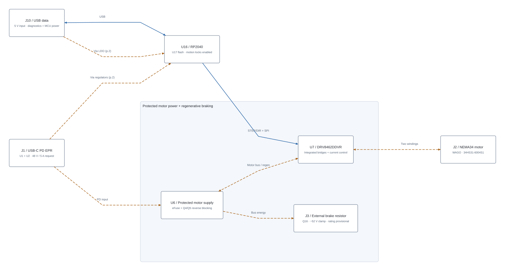

# NEMA34 48 V EPR controller — RP2040 redesign

[System block diagrams and operating sequence](https://github.com/techmannih/pd1180-epr/blob/main/docs/system-overview.md).



**Design revision 0.5.0-RP2040-DRAFT — implementation and commissioning handoff.** The source now uses RP2040, DRV8262DDVR with integrated power bridges, TPS26750 for the retained 48 V / 5 A EPR input, and an optional AS5600. The stocked-driver ECO follows merged PR #27 (`5035034`) and retains that 48 V architecture. Use the assembly and commissioning guides below to prepare the order and collect physical results after assembly.

Start with [the nine-sheet power/component review](https://github.com/techmannih/pd1180-epr/blob/main/docs/usb-pd-architecture.md), [current reference-board decisions](https://github.com/techmannih/pd1180-epr/blob/main/docs/reference-review.md), [the redesign and evidence](https://github.com/techmannih/pd1180-epr/blob/main/docs/rp2040-redesign.md), [reviewer checklist](https://github.com/techmannih/pd1180-epr/blob/main/docs/reviewer-checklist.md) and [firmware instructions](https://github.com/techmannih/pd1180-epr/blob/main/firmware/README.md). `index.circuit.tsx` is the current schematic/placement source. The DATA-only source, firmware and native route are synchronized. The paired native review archive contains fresh DRC/ERC reports: 8 retained USB hole-clearance errors, 488 cosmetic warnings, and zero other errors, unconnected items or schematic-parity/ERC findings. The older GUI screenshot is explicitly historical.

The new commissioning firmware is an ARM RP2040 image with verified ELF/BIN/UF2 format and matching source hashes. The default image remains diagnostics-only. Separate stationary-power and bounded motor-test profiles provide the post-assembly workflow: <=0.8 A RMS request, 10 rpm, 10 seconds, local START and automatic stop. Use [programming, readback and commissioning](https://github.com/techmannih/pd1180-epr/blob/main/docs/commissioning.md). Physical measurements are performed by the assembly/test team; the software results do not claim them.

The hosted preview opens `release/circuit.json`; its routed payload has been regenerated from the verified native board and checked against this DATA-only source. `index.circuit.tsx` remains editable; `bun run dev` opens that source. The PCB carries the matching 0.5 DRAFT revision marking.

| Function | This design |
| --- | --- |
| U16 MCU / U17 boot storage | RP2040 / W25Q32JV, 4 MiB QSPI flash, 12 MHz crystal; powered only from J10 DATA |
| U7 motor stage | DRV8262DDVR, top-cooled DDV package; PH/EN motion with U42 MCP4822 dual current references |
| Power | TPS26750 EPR sink, dedicated J1; independent DATA/logic-power J10 |
| PD monitoring | U38 INA237 measures raw PD_VBUS; ADS1115 retains protected VMOTOR. Fresh ADC conversion + TPS contract produce PD_READY; eFuse MOTOR_PG stays independent. |
| Terminals | J2 WAGO 2601-3104 motor; J3 WAGO 236-402 brake. No JST mating plugs; paired solder tails belong to each wire entry. |
| Encoder | AS5600 I²C, optional DNP U18 on bottom; C52/C53 on top |
| Protection | Independent eFuse, voltage window, thermal inhibit, hardware enable gates and external J3 braking resistor retained |
| Motor | STEPPERONLINE 34HS31-6004S1, 6 A/phase motor rating; initial bench-test requests <=0.8 A RMS |
| Mounting | Four motor-CAD-aligned holes; choose screws/spacers from measured rear thread/depth and physical fit |

For order preparation, use [fabrication and assembly instructions](https://github.com/techmannih/pd1180-epr/blob/main/docs/assembly.md), [the exact-part sourcing snapshot](https://github.com/techmannih/pd1180-epr/blob/main/docs/procurement.md) and [manufacturer acceptance checklist](https://github.com/techmannih/pd1180-epr/blob/main/docs/manufacturing-acceptance.md). They separate the supplied files/software from supplier allocation, installation and post-assembly measurements.

Source/firmware development checks:

```sh
bun install --frozen-lockfile
bunx tsci build index.circuit.tsx --routing-disabled --disable-parts-engine
bun run typecheck
bun run check:firmware-pins
bun run check:firmware
bun test scripts/rp2040-contract.test.mjs scripts/encoder-bypass-policy.test.mjs
bun run check:schematic-style
```

Run `bun run review` for all engineering and artifact checks; consult its generated report. The machine-readable release record separately retains manufacturer acceptance, sourcing and physical-test evidence.

The completed reviewer scope and remaining physical acceptance steps are in [the handoff](https://github.com/techmannih/pd1180-epr/blob/main/docs/completion-handoff.md). The [ordered-motor manufacturer STEP archive](https://github.com/techmannih/pd1180-epr/blob/main/engineering/mechanical/34HS31-6004S1-manufacturer.zip) establishes the rear hole axes; it does not approve replacement screws or engagement depth.

Previous-board context: [historical README](https://github.com/techmannih/pd1180-epr/blob/main/docs/legacy-stm32-tmc-readme.md). It is retained for review, not as evidence for the redesign.

**DATA-only MCU:** J10 supplies RP2040 even when J1 PD is connected. PD alone cannot run local controls. Board-side I²C and status signals are isolated through U39/U40; the brake retains independent motor-bus power. See [power domains](https://github.com/techmannih/pd1180-epr/blob/main/docs/usb-pd-architecture.md).
