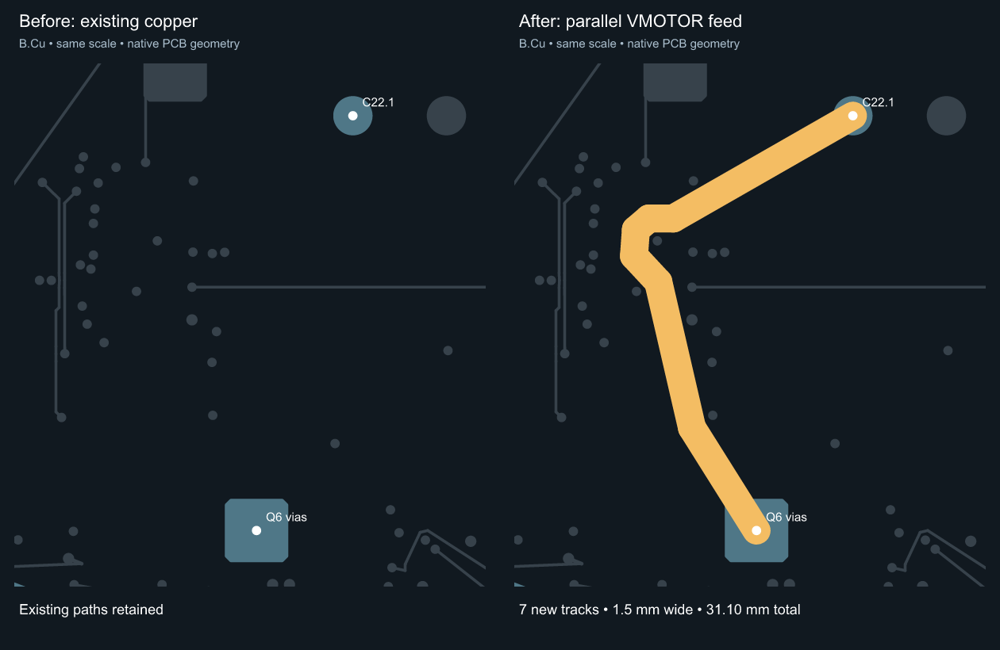

# Parallel VMOTOR feed review — 2026-10-28

The baseline is main `952de54ca0b5dbe042d9ccc9a1a9ecf3e8f67779`. Its freshly refilled native PCB already has zero electrical DRC errors. This revision improves a long supply path; it does not claim that the previous copper pours were inherently invalid.

Seven **1.5 mm B.Cu track segments**, total length **31.10 mm**, add a parallel connection from bulk capacitor **C22 pin 1** to **Q6's existing four drain thermal vias**. These are native tracks, not new pour polygons. Every original track, via, footprint, pad, net, zone outline, keepout, board edge and mounting hole is preserved. Schematic and firmware are unchanged; all motion locks remain enabled. No existing power or GND pour is removed, since this change has no evidence that removing one improves the design.



The image uses native copper geometry at identical scales. The amber overlay is the added feed; it is not a KiCad DRC-dialog screenshot.

## Checks and limits

- Fresh KiCad 10.0.5 refill, all-track errors, all severities and schematic parity: **0 errors, 0 unconnected items, 0 parity issues**. All-sheet ERC: **0**.
- The exact **401 existing cosmetic warnings** remain: 189 text-height, 117 silk-over-copper and 95 silk-overlap. No finding is hidden and this is not zero total violations.
- Minimum track width **0.15 mm**, GND clearance **0.30 mm**, GND inset **0.50 mm**, global copper-edge rule **0.20 mm**, and the separate **0.09 mm connection/groove** constraints remain active.
- Native Kelvin isolation, all 44 bypass paths plus buzzer bulk, USB return-plane coverage and the brake-divider disconnection test pass on the revised board.
- `routing/power-feed.json` and `scripts/power-feed.mjs` bind the seven exact additions to the complete original geometry. Negative tests reject missing/narrowed feed tracks, wrong baselines and unrelated copper edits. The historical protected-geometry hash remains intact.
- Fresh manufacturing output includes the paired native project and schematics, Gerbers, drills, BOM/CPL and previews. Native filled polygons are independently compared with Gerber conductor regions.

## Actual-filled-copper DC comparison

All 18 paths were evaluated at 0.075 and 0.05 mm mesh. SENSE_A Q9 and SENSE_B Q13 additionally use 0.025 mm refinement to meet the existing 3% adjacent-mesh criterion. The table uses the common 0.05 mm mesh. No path resistance increased. VMOTOR to Q6 improves by about **57%**, Q8 by **43%**, Q10 by **12%**, and Q12 by **24%**. The brake path is unchanged.

| Net | Terminal path | Before mΩ | After mΩ | Change |
|---|---|---:|---:|---:|
| `MOTOR_A1` | `Q7:9 → R115:1` | 2.8122 | 2.8122 | +0.00% |
| `MOTOR_B1` | `Q11:9 → R116:1` | 6.4826 | 6.4826 | +0.00% |
| `MOTOR_A1_OUT` | `R115:2 → J2:1` | 4.9481 | 4.9481 | +0.00% |
| `MOTOR_A2` | `Q9:9 → J2:2` | 10.3540 | 10.3540 | +0.00% |
| `MOTOR_B1_OUT` | `R116:2 → J2:3` | 6.4234 | 6.4234 | +0.00% |
| `MOTOR_B2` | `Q13:9 → J2:4` | 7.1209 | 7.1209 | +0.00% |
| `PD_VBUS` | `J1:7,8,17,18 → Q4:1,2,3` | 13.4840 | 13.4840 | +0.00% |
| `EFUSE_IN` | `Q4:9 → U6:1,2` | 9.5802 | 9.5802 | +0.00% |
| `VMOTOR` | `U6:17,18 → Q6:9` | 36.0701 | 15.3728 | -57.38% |
| `VMOTOR` | `U6:17,18 → Q8:9` | 29.8408 | 16.9331 | -43.26% |
| `VMOTOR` | `U6:17,18 → Q10:9` | 15.9179 | 14.0028 | -12.03% |
| `VMOTOR` | `U6:17,18 → Q12:9` | 21.8625 | 16.5705 | -24.21% |
| `VMOTOR` | `U6:17,18 → J3:1` | 1.8078 | 1.8078 | +0.00% |
| `SENSE_A` | `Q7:1,2,3 → R109:1` | 5.4103 | 5.4103 | +0.00% |
| `SENSE_A` | `Q9:1,2,3 → R109:1` | 1.2207 | 1.2207 | +0.00% |
| `SENSE_B` | `Q11:1,2,3 → R110:1` | 2.0730 | 2.0730 | +0.00% |
| `SENSE_B` | `Q13:1,2,3 → R110:1` | 1.2871 | 1.2871 | +0.00% |
| `BRAKE_RETURN` | `J3:2 → Q16:9` | 1.7917 | 1.7917 | +0.00% |

Assumptions: 35 µm copper at 20 °C, 20 µm via plating, equally spaced layers through a 1.6 mm board, ideal terminal contacts and a nine-point DC conductance mesh. Connector, shunt and MOSFET resistance, PWM/AC behaviour and temperature feedback are excluded. The model's 5.5 A loss figures are comparison values, not continuous-current qualification. The configured motor ceiling remains 3.8 A RMS; the additional feed does not authorize raising it or unlocking motion.

## Reproduction and downloads

Extract the native PCB and paired `.kicad_pro` from main `952de54`'s `release/pd1180-epr-r0.3-kicad.zip`. Run:

```sh
bun scripts/power-feed.mjs --apply BASELINE/pd1180-epr-r0.3.kicad_pcb NEW_DIRECTORY
kicad-cli pcb drc --all-track-errors --refill-zones --save-board --severity-all --format json --output replay-drc.json NEW_DIRECTORY/pd1180-epr-r0.3.kicad_pcb
```

Replay refuses an unexpected baseline or an existing output directory. The native check and negative tests run within `bun run review`. Detailed paths, meshes, hashes and model limitations are in [the current engineering evidence](../engineering/copper-geometry-review.json).

Use the matching [native KiCad ZIP](../release/pd1180-epr-r0.3-kicad.zip), including its project settings and schematics. The tscircuit website's standard KiCad button performs a separate conversion. Upstream board-edge and zone-clearance fixes remain pending; this native-board change does not deploy that shared exporter or certify its downloads. The TSX-to-JSON clearance-preservation gap observed in reference boards is also separate.

The earlier pour consolidation and source-rule corrections remain in Git history at `a58e277` and `952de54`; [source-design-rules.md](source-design-rules.md) explains the retained rules. Physical programming/readback, EPR/brake/heatsink, secure mounting, switching transients, thermal/EMC testing and current supplier shortages remain tracked in [readiness.md](readiness.md). No order or powered-operation approval is implied.

The [TMC5160A layout guidance, pp. 15–21](https://www.analog.com/media/en/technical-documentation/data-sheets/tmc5160a_datasheet_rev1.18.pdf) recommends compact switching loops, short connections and solid common ground. The added feed supplements existing local decoupling; it is not a measured transient or thermal result.
