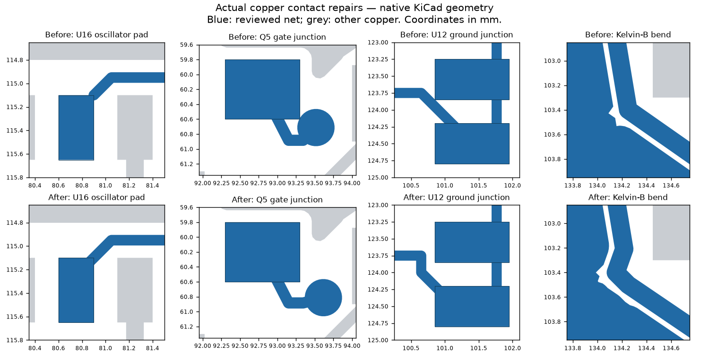

# Copper geometry correction — 2026-10-20

**Current revision:** see [source-design-rules.md](source-design-rules.md) for the 2026-10-27 source/native rule correction and current evidence. The discussion and image below describe the earlier 2026-10-20 consolidation; its original report is retained in Git history at a58e277.

The original main board `8139bca` passed connectivity while its minimum connection-width rule was disabled. Enabling **0.09 mm** exposed **17 connection-width findings**. This revision repairs those findings and consolidates the power pours. It preserves all **3,023 schematic records, 281 footprints, placements, pad nets, board outline, four mounting holes and firmware motion locks**.

## What changed

- Union 851 overlapping power-corridor zones into 79 same-net/layer outlines, including their cutouts. Apply a 0.30 mm corner chamfer, 0.20 mm minimum fill and the existing 0.16 mm clearance. Keep disconnected outlines separate; refill against actual pads, tracks and keepouts.
- Correct U16 OSC_IN pad entry; shift the Q5 gate-via junction by 0.10 mm in X/Y with its attached tracks; reconnect U12 ground without grazing a pad corner; add a short source-matched Kelvin-B bend and reservation keepout.
- Increase In1 ground-plane minimum fill from 0.20 to 0.25 mm. Ground-return, USB-reference and 44 native decoupling checks pass on the refilled board.
- Enable and guard 0.09 mm minimum connection/groove rules. Warning suppression, legacy unchamfered corridors and width regressions now fail portable verification.
- Make the nominal corridor-coverage checker subtract polygon cutouts. A 2.4 mm outline envelope is **not** evidence that the clipped copper is 2.4 mm wide or rated for 5.5 A.

Right angles alone do not make copper invalid. The meaningful corrections are adequate contact geometry, active manufacturing constraints, preserved sense/return paths and checks of the **actual filled copper**. Clearance clipping can still create irregular boundaries; this is not a claim that every boundary is rounded or every angle is 45°.

## Evidence

- Native KiCad, all track errors, all severities, fresh refill and schematic parity: **0 connection-width, other electrical, unconnected or parity findings**. All-sheet ERC: **0**.
- Exactly **401 existing cosmetic findings** remain: 189 text-height, 117 silk-over-copper and 95 silk-overlap. Their accepted signature and all native text are unchanged. No zero-total-DRC claim.
- Kelvin terminal-only joins, brake-divider branch-removal check, native bypass paths and USB reference continuity pass. The historical protected-geometry hash is retained using an explicit reversible copper revision; unrelated geometry is not re-baselined away.
- Exported Gerber conductor regions match native filled polygons on all four layers: **39 net/layer comparisons, zero symmetric-difference area**. Gerbers, drill data, BOM/CPL, native project, previews and release hashes are regenerated from this board.
- [Machine-readable review](../engineering/copper-geometry-review.json) binds the board, checks, before/after results and model sources to their hashes. The release package contains a same-name copy. [Existing motor-path evidence](../engineering/filled-copper-review.json) is refreshed too.

## Actual-fill DC comparison

18 paths were solved before/after at 0.075 and 0.05 mm mesh. SENSE_A Q9 and SENSE_B Q13 showed 4.17% and 3.29% initial mesh differences, so each was additionally solved at **0.025 mm** on both revisions; the final adjacent-mesh difference is below 3%. The table retains the common 0.05 mm mesh for comparison. Maximum resistance increase is **2.53%** (0.0512 mΩ); VMOTOR-to-Q6 decreases by 1.70%. This is a geometry regression screen, not a thermal rating.

| Net | Terminal path | Before mΩ | After mΩ | Change |
|---|---|---:|---:|---:|
| `MOTOR_A1` | `Q7:9 → R115:1` | 2.8313 | 2.8119 | -0.69% |
| `MOTOR_B1` | `Q11:9 → R116:1` | 6.4825 | 6.4826 | +0.00% |
| `MOTOR_A1_OUT` | `R115:2 → J2:1` | 4.9184 | 4.9497 | +0.64% |
| `MOTOR_A2` | `Q9:9 → J2:2` | 10.7007 | 10.7060 | +0.05% |
| `MOTOR_B1_OUT` | `R116:2 → J2:3` | 6.4229 | 6.4234 | +0.01% |
| `MOTOR_B2` | `Q13:9 → J2:4` | 7.1207 | 7.1209 | +0.00% |
| `PD_VBUS` | `J1:7,8,17,18 → Q4:1,2,3` | 13.4712 | 13.4713 | +0.00% |
| `EFUSE_IN` | `Q4:9 → U6:1,2` | 9.4349 | 9.6010 | +1.76% |
| `VMOTOR` | `U6:17,18 → Q6:9` | 36.6346 | 36.0103 | -1.70% |
| `VMOTOR` | `U6:17,18 → Q8:9` | 30.3223 | 29.8337 | -1.61% |
| `VMOTOR` | `U6:17,18 → Q10:9` | 15.9289 | 15.9138 | -0.09% |
| `VMOTOR` | `U6:17,18 → Q12:9` | 21.8728 | 21.8584 | -0.07% |
| `VMOTOR` | `U6:17,18 → J3:1` | 1.8031 | 1.8037 | +0.03% |
| `SENSE_A` | `Q7:1,2,3 → R109:1` | 5.4042 | 5.3999 | -0.08% |
| `SENSE_A` | `Q9:1,2,3 → R109:1` | 1.2150 | 1.2150 | +0.00% |
| `SENSE_B` | `Q11:1,2,3 → R110:1` | 2.0218 | 2.0730 | +2.53% |
| `SENSE_B` | `Q13:1,2,3 → R110:1` | 1.2869 | 1.2871 | +0.02% |
| `BRAKE_RETURN` | `J3:2 → Q16:9` | 1.7911 | 1.7917 | +0.03% |

Assumptions: 35 µm copper at 20 °C, 20 µm via-barrel plating, 1.6 mm equally spaced stack, ideal terminal contacts and a nine-point DC conductance mesh. Excludes connector/shunt/MOSFET resistance, AC/PWM effects and temperature feedback. Recorded losses at 5.5 A are comparison values, not a continuous-current qualification. Rectangular-sheet and via-barrel model tests pass. Preparing polygon spatial indexes accelerates membership queries without changing the model; all 34 completed pre-optimization results reproduce exactly to the recorded precision.

## Reproduce and release limits

Run `bun install --frozen-lockfile` and `bun run review` for the portable engineering review. To regenerate the ECO, extract the baseline PCB **and its .kicad_pro** from `8139bca`, compile current source with `bun run build:preview`, and run `scripts/refine-copper-geometry.py BASELINE OUTPUT` using KiCad's Python. This refuses an unknown baseline or in-place overwrite. Then run fresh native DRC/ERC, native copper checks, manufacturing export and the actual-fill model commands recorded in the JSON evidence. The numerical dependencies are `numpy==2.0.2 scipy==1.13.1 shapely==2.0.7`.

**Ordering and powered operation remain held.** Fresh official stock records shortages for R60/C326731, BZ1/C391032, R65/C723637 and U6/C1850276. No automatic substitutions are included. TI/STM32 programming/readback/cold boot, the actual EPR adapter/cable, brake/heatsink qualification, mounting and staged motor/thermal/EMC tests remain in [readiness.md](readiness.md). Motion locks remain enabled.

References: [KiCad PCB rules and zones](https://docs.kicad.org/10.0/en/pcbnew/pcbnew.html), [TI motor-driver layout guidance](https://www.ti.com/lit/an/slva959b/slva959b.pdf), and [Eurocircuits copper-layer guidance](https://www.eurocircuits.com/technical-guidelines/pcb-design-guidelines/copper-layers/). These explain the review method; they do not certify this board.
