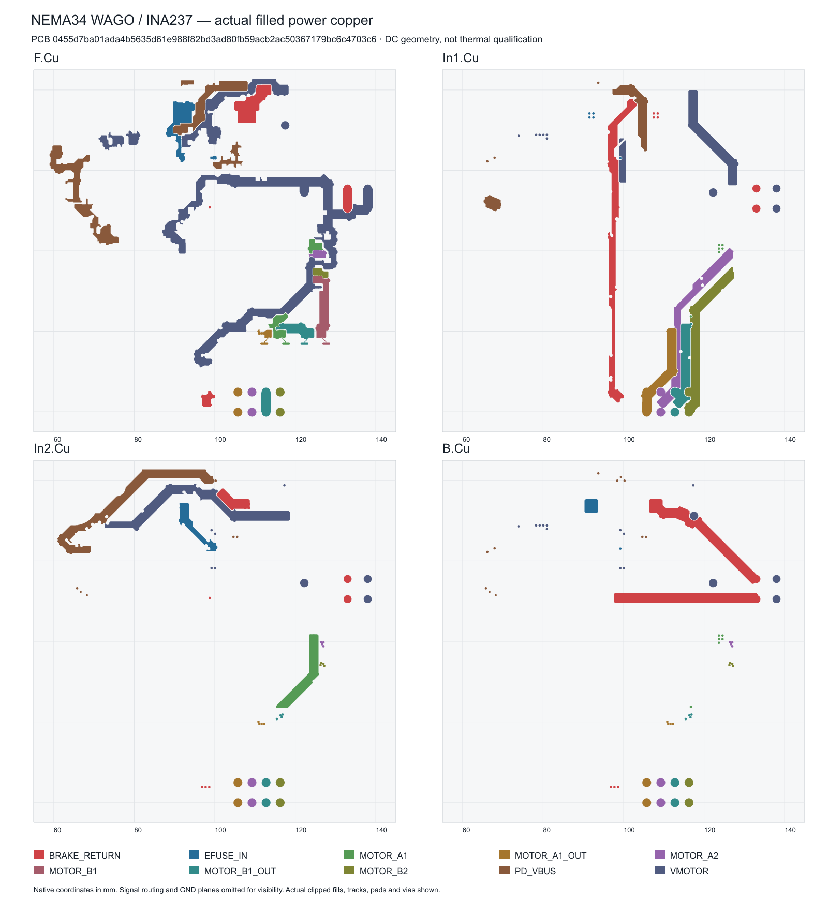

# RP2040 / DRV8462 native copper review

The baseline is the connected RP2040/DRV8462 route before reinforcement. It is not the old STM32/TMC5160 board. Final traces, filled zones, parallel phase vias and terminal-only Kelvin branches are checked against the actual exported native PCB. All four motor output nets have at least four power vias; the routed current paths are separately screened below.

Native KiCad reports **8 errors, all retained J1/J10 hole clearances**, **0 unconnected**, **0 parity**, and **0 ERC**. The 434 cosmetic warnings remain visible. No additional clearance, narrow-connection, dangling-track/via or hole-spacing findings remain. Track width ≥0.15 mm, GND clearance ≥0.30 mm, GND edge inset ≥0.50 mm, global copper-edge clearance 0.20 mm, and connection/groove width ≥0.09 mm are unchanged.

All 54 bypass paths, four Kelvin terminal-only branches, USB reference/stitching and brake-current-path classifications pass. `routing/power-feed.json` binds the new architecture's exact VMOTOR tracks and remaining native geometry; its old seven-segment TMC recipe is historical and cannot be replayed onto this board.

## Actual filled-copper DC comparison

All 11 paths use 0.075 and 0.05 mm meshes, with 0.025/0.02 mm refinement where required to achieve ≤3% adjacent-mesh difference. The table uses the common 0.05 mm mesh. The raw baseline/final geometry, boards and numerical results are in `engineering/rp2040-copper-evidence.zip`.

| Net | Terminal path | Before mΩ | After mΩ | Change |
|---|---|---:|---:|---:|
| MOTOR_A1 | U7:17,18,19 → R115:1 | 29.364 | 9.148 | -68.8% |
| MOTOR_B1 | U7:4,5,6 → R116:1 | 13.467 | 3.158 | -76.5% |
| MOTOR_A1_OUT | R115:2 → J2:1 | 20.682 | 5.054 | -75.6% |
| MOTOR_A2 | U7:14,15,16 → J2:2 | 46.140 | 13.130 | -71.5% |
| MOTOR_B1_OUT | R116:2 → J2:3 | 27.027 | 5.737 | -78.8% |
| MOTOR_B2 | U7:7,8,9 → J2:4 | 36.924 | 8.012 | -78.3% |
| PD_VBUS | J1:7,8,17,18 → Q4:1,2,3 | 72.365 | 20.897 | -71.1% |
| EFUSE_IN | Q4:9 → U6:1,2 | 15.773 | 6.792 | -56.9% |
| VMOTOR | U6:17,18 → U7:2,11,12,21 | 68.928 | 18.570 | -73.1% |
| VMOTOR | U6:17,18 → J3:1 | 9.368 | 3.246 | -65.3% |
| BRAKE_RETURN | J3:2 → Q16:9 | 6.210 | 1.410 | -77.3% |

These are 20°C copper-only estimates. They omit component/contact losses, temperature rise, switching and electromagnetic effects; they do not rate the board for 6 A. The motor-current envelope, DDV heatsink/TIM, retained 1 oz stack and external brake installation remain unqualified. Motion locks and the order hold remain enabled.
