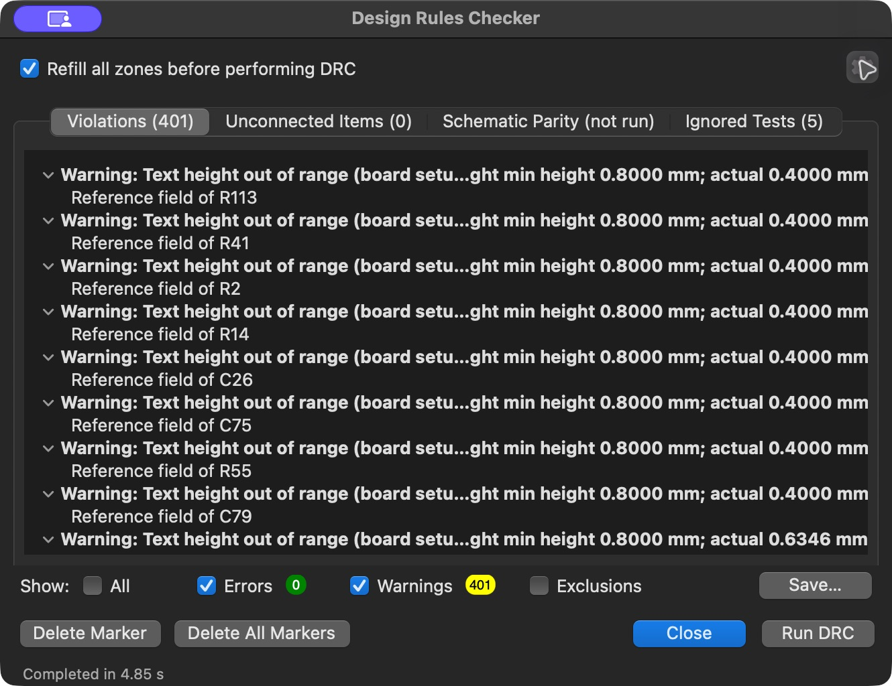

# KiCad download verification — 2026-10-27

[Download the native project ZIP](https://raw.githubusercontent.com/techmannih/pd1180-epr/952de54ca0b5dbe042d9ccc9a1a9ecf3e8f67779/release/pd1180-epr-r0.3-kicad.zip). Extract every file together and open `pd1180-epr-r0.3.kicad_pro`.

Fresh download from main `952de54`, checked with KiCad 10.0.5:

| Check | Result |
|---|---:|
| Refilled DRC, all-track checking | 0 errors, 401 cosmetic warnings |
| Unconnected / schematic parity / ERC | 0 / 0 / 0 |
| Minimum actual track width | 0.15 mm |
| GND clearance / edge inset | 0.30 / 0.50 mm |

ZIP SHA-256: `f39a6fcd5567c988aad59651e1a563caefe777e711ca2ccd3949c1018e1654b8`.
PCB SHA-256: `2880cf5c42f62f26465c4ceb164357e5228ccf19ff86d115c116c3b1ec52891e`.



The GUI screenshot is a standalone PCB run; parity was separately run by CLI. [Raw reports and comparison evidence](../engineering/kicad-download-evidence.zip) retain all findings. Five existing ignored tests cover footprint filters/type, missing courtyards, track centering and tuning profiles. There are no explicit DRC exclusions; copper checks remain active. This is not zero total violations or hardware/order approval.

## Reproduce

With Bun and KiCad installed, from this checkout:

```sh
bun scripts/check-kicad-download.mjs --download 952de54ca0b5dbe042d9ccc9a1a9ecf3e8f67779 --output /tmp/pd1180-download-check
```

The output directory must be new. Set `KICAD_CLI`/`KICAD_PYTHON` on other installations. `--input ZIP` checks an existing download. Every member is compared with this checkout's release; fresh DRC/refill/all-track/parity/ERC and geometry checks run on the extracted files without repair/save. ZIP, hashes and raw reports remain in the output. Regression: `bun test scripts/kicad-download.test.mjs`. A disposable copy with global edge clearance changed to 0.50 mm was rejected with 25 fresh DRC errors and a project hash mismatch.

## Shared website export still needs a fix

Website v0.3.95 (`a170e23e-c799-422d-b275-db5267c84ddf`) has the same main revision and matching published viewer JSON. Its generic download nevertheless has 17 GUI errors (25 expanded), 641 warnings and 604 parity findings. Parity findings are not physical shorts. All 6,103 tracks match native, but:

- Global copper-edge 0.20 mm is omitted, so KiCad defaults to 0.50 mm; GND's separate 0.50 mm inset is unrelated.
- GND clearance becomes 0.15 instead of 0.30 mm, power-zone settings change, and 24 rule areas disappear.
- Seven CC vias duplicate; schematic/PCB associations and one dangling-track warning also need correction.

Restoring only global edge clearance removed the 17 error entries in a diagnostic copy, but did not restore these other losses.

The [website download function](https://github.com/tscircuit/tscircuit.com/blob/main/src/lib/download-fns/download-kicad-files.ts) runs shared converters on Circuit JSON, not this native ZIP. Those converters need rule/zone/keepout, net-resolution and schematic-association fixes plus deployment. A board dependency change cannot update that website code. This change supplies a verified native handoff and download check; it does **not** fix or certify the generic button.
