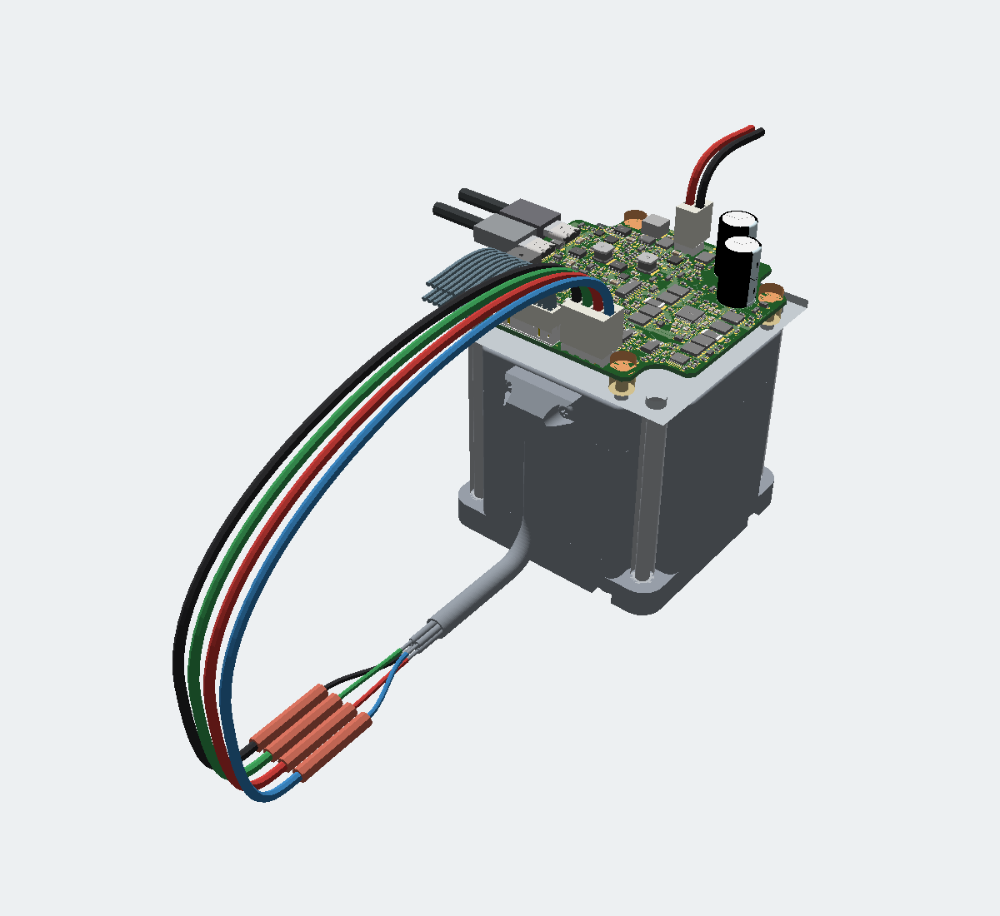
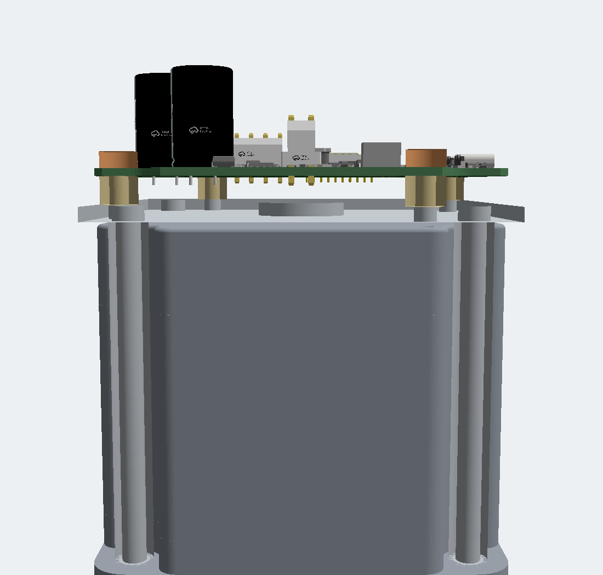

# Ordered 34HS31-6004S1 motor assembly

The user confirmed the ordered motor on 2026-10-11: **STEPPERONLINE 34HS31-6004S1**, Amazon ASIN **B091C83HWF**. This supersedes the earlier QSH8618 selection. The manufacturer specifies 4.8 Nm holding torque, 6 A/phase, an 86 mm frame, 80 mm maximum body length and a single Ø14 × 32 mm front shaft. The phase-current rating is not an approved driver RMS setting.

The [manufacturer STEP](https://files.omc-stepperonline.com/34HS31-6004S1.STEP) is preserved inside `engineering/mechanical/34HS31-6004S1-manufacturer.zip` as `34HS31-6004S1.step`, SHA-256 `675e55f1d50271255bbd058d8c2e867ecced44b194ded1586c63da77ce1c8a19`. The [datasheet](https://files.omc-stepperonline.com/34HS31-6004S1_Full_Datasheet.pdf) is preserved in the same archive; `motor-data.json` records its hash and electrical inputs. The superseded QSH files remain available in Git history. The archive preserves the original manufacturer bytes while keeping the cloud import within its payload limit.

**Direct rear PCB mounting and rear encoder attachment are not established.** The documented mounting interface is the front flange. Existing rear case fasteners are not approved accessory threads; do not remove them or drill the motor based on this preview.

The default hosted 3D view includes the exact motor, routed PCB, adapter proposal and mating harness. Open `motor-assembly.circuit.tsx` for the source mechanical fit study. It uses `assembly.subassembly` and the manufacturer STEP converted to GLB. Fasteners, washers and spacers are separate named nominal models. No encoder holder or magnet is modeled for this motor. Custom supports are **proposals, not fabrication-released hardware**. `release/circuit.json` remains the authoritative routed PCB view and now also includes the motor, adapter and harness mechanical models. Its generator rejects any assembly change to the verified board records. Runtime inline models are pinned to an immutable Git commit and checked against the local CAD hashes; no moving branch URL is used.

The exported assembly is checked for the PCB/motor axis mapping and **10 mm nominal** rear-face-to-PCB-bottom gap. `release/34hs31-6004s1-assembly-proposal.zip` contains the same assembly as an offline GLB.

## PCB screw clearance

The PCB hole pattern now follows the **ordered motor's rear CAD axes**, not the mirrored TMCM-1180 pattern. `engineering/mechanical/ordered-motor-pcb-reference.json` records the source STEP hash, coordinate system and exact centers. `scripts/motor-mounting-geometry.mjs` resolves the cylindrical axes directly from the BREP; the regression rejects the previous pattern. The PCB source and native manufacturing drill positions are checked against this pattern.

| Hole | PCB X (mm) | PCB Y (mm) |
|---|---:|---:|
| H1 | 24.447132 | -38.374311 |
| H2 | 38.374311 | 24.447132 |
| H3 | -24.447132 | 38.374311 |
| H4 | -38.374311 | -24.447132 |

All four drills remain Ø4.2 mm. Motor and board XY coordinates share the same orientation; no model reflection disguises the pattern. Connector and nearby component placement, local routing and the adapter's PCB holes are updated to provide clearance. Those earlier mounting/connector-position corrections preserved electrical connectivity. The 12 October interface ECO separately removes the unsupported bus/general-I/O circuits; see `product-eco.md`.

The component-mesh screen uses an 8 mm maximum head/washer diameter and 2.7 mm height above the PCB, with at least 0.5 mm nominal component clearance.

| Hole | Nearest component | Nominal head clearance (mm) |
|---|---|---:|
| H1 | R89 | 0.5563 |
| H2 | D10 | 0.6471 |
| H3 | C89 | 0.8562 |
| H4 | D17 | 0.5475 |

Both outer copper layers have a 4.25 mm radius keepout around each screw axis for the metal head and standoff. The latest measured component clearances and motor/PCB axis offsets are recorded in `motor-assembly-check.json`.

These are imported CAD-body clearances, not a tolerance study. Use M4 hardware whose complete head and washer remain within Ø8 mm. A larger washer is outside this check. Assembly tolerances and tool access remain to be qualified.

## Motor connector body clearance

J2 is a top-entry JST B4P-VH connector. Its pads fitted on the previous layout, but the imported body overhung the bottom edge by **1.95 mm**. The connector is now shifted **2.50 mm inward** to PCB `(11.8, -37.6)` mm; its pin map, footprint and CAD origin are unchanged. The full body envelope leaves **0.55 mm nominal board-edge clearance**.

R65, R84, R85, R86, C41 (R78 was later removed in the interface ECO) have local placement adjustments to keep the connector body and component courtyards clear. C41 remains beside U14, with its final native bypass path checked. The motor connector label is beside the body between J7 and J2. Routing and fabrication data are regenerated from this placement; the schematic and mounting-hole coordinates are unchanged.

The release geometry check measures the complete exported J2 mesh envelope against the board perimeter and neighboring component envelopes, requiring at least **0.50 mm** in each case. It rejects the previous overhanging model. This check does not replace connector/mating-harness tolerance or physical assembly validation. The [JST VH drawing](https://www.jst-mfg.com/product/pdf/eng/eVH.pdf) is the manufacturer reference.

## Revision B adapter and hardware

The current stack is specified in [product correction](product-eco.md#mechanical-parts-and-fabrication) and `engineering/mechanical/assembly.json`. Four NBK SHBS-M5-80 posts (80 mm, 8 mm AF), a 3 mm 6061-T6 plate and four 6 mm Essentra spacers put the PCB bottom **19.5 mm** above the CAD rear face. The plate sits 10.5 mm above that face. Exact front-flange CAD centers remain ±34.75 mm; PCB hole centers above are unchanged.

Nominal minimum post-to-case clearance is **0.607 mm**. The M4 washer/head stack is 2.7 mm high and 8 mm maximum diameter. The selected DIN433 M4 washer is 0.5 mm thick; ISO7089's larger washer is not interchangeable. Fasteners, thread engagement, fabrication drawings and pending supplier SKUs are listed in the product correction. The assembly uses the front flange and custom plate, not rear motor case screws.

Fabrication DXF/SVG/hole table and support/cap STLs are in `engineering/mechanical/fabrication`. These are custom prototype designs awaiting manufacturer DFM, tolerance/strength/heat/pull qualification and approval to share the machine's front mounting interface. No purchased or qualified kit is claimed.

## Encoder attachment unresolved

U18, C52 and C53 are optional bottom-side footprints marked `doNotPlace`. U18 is centered on the motor axis; all three are excluded from the fitted BOM/CPL and solder paste. R74 remains fitted on top so the absent SPI device stays deselected. The ordered motor STEP is a single fused mesh. It shows a rear central recess, but does not identify a rotating shaft end, usable pilot bore/thread or approved magnet attachment. A visible rear recess is not proof that a holder can be attached to the rotor.

The old QSH-specific pilot, PEEK holder, magnet dimensions and working-gap calculation are withdrawn. Manufacturer confirmation of rear rotating-shaft access is required before defining a new attachment. If there is no usable rear shaft, an alternative encoder coupling or motor variant must be agreed; the current preview does not resolve that choice.

Any eventual magnet must meet the AS5047P field, alignment and temperature requirements at the bottom-side sensor. Retention, runout and magnetic performance need qualification. Closed-loop operation remains unqualified.

## Before mechanical release

1. Approve use of the front machine-mount holes and finalize bracket/post fasteners, tolerances and cable access.
2. Establish rear rotating-shaft access and an appropriate encoder attachment, or agree an alternative arrangement.
3. Select and qualify the magnet/holder, field and working gap if magnetic feedback is retained.
4. Qualify physical fit, tool access, support strength, retention and vibration.

Motor identity is now confirmed. The manufacturer specifies 1400 g cm² rotor inertia. Driver current/hold settings, external load inertia, speed and stopping duty remain unqualified. These mechanical and operating gates are additional to the existing PD-image, firmware and powered-test holds.

References: [ordered Amazon listing](https://www.amazon.com/dp/B091C83HWF), [manufacturer product](https://www.omc-stepperonline.com/s-series-nema-34-stepper-motor-4-8nm-679-87oz-in-14mm-key-way-shaft-1m-cable-34hs31-6004s1), [AS5047P datasheet](https://look.ams-osram.com/m/d05ee39221f9857/original/AS5047P-DS000324.pdf), [tscircuit subassembly](https://docs.tscircuit.com/elements/assembly-subassembly).

## Drill visibility and export verification

The four mounting apertures are Ø4.2 mm NPTH through holes. Their coordinates
are checked independently in the compiled source, native board, actual metric
Excellon drill file and exported PCB substrate mesh. The 3D check measures the
open radius through the substrate, so a green surface covering a hole cannot
pass merely because a `pcb_hole` record exists. Missing, shifted, duplicated,
wrong-diameter and capped-hole regressions are covered by the mounting tests.

The assembly proposal includes solid orange screw-head clearance envelopes.
These intentionally cover the holes when the adapter/fastener model is visible;
they are mechanical fit envelopes, not copper or plugged PCB holes. Use the
bare-board view to inspect the apertures. Manufacturing drilling is supplied in
`pd1180-epr-r0.3-NPTH.drl` inside the Gerber ZIP, separate from the copper layers.

For a current-source inspection without waiting for a hosted release, run
`bunx tsci dev motor-assembly.circuit.tsx`, select 3D, right-click a screw-head
envelope and choose **Hide "adapter_proposal"**. This changes only viewer
visibility. The [local source screenshot](../previews/current-source-mounting-holes.jpg)
shows all four PCB openings with the ordered motor still visible.

## Mating cables

The assembly now includes a separate `harness_proposal` model: the J2 motor loop and splices, J3/J7 mates with outgoing leads, and two generic USB access gauges. See [complete-assembly.md](complete-assembly.md) for the model boundaries, cavity mapping, installation order and remaining physical checks.
