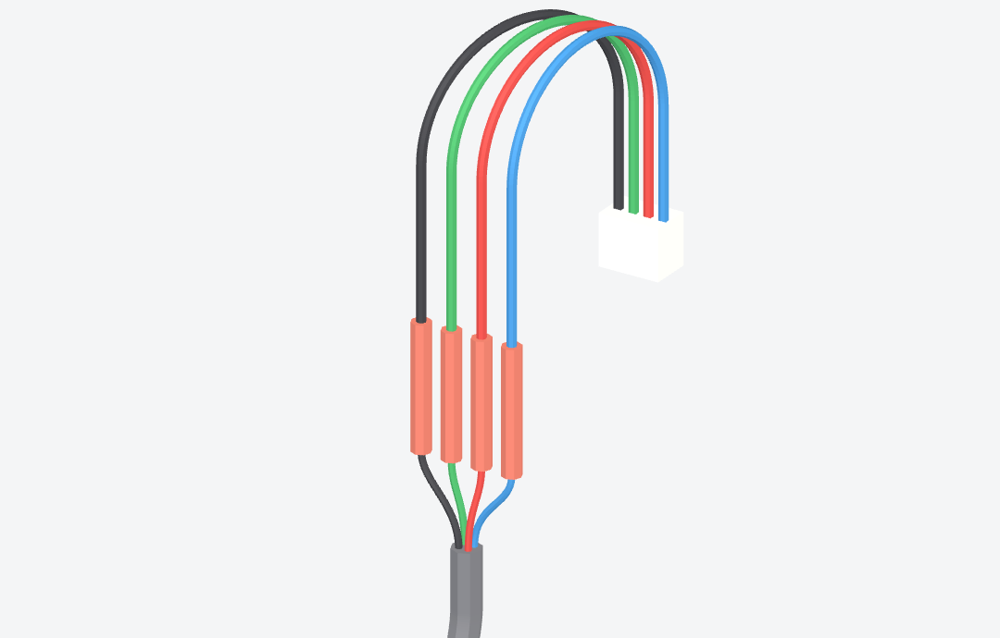
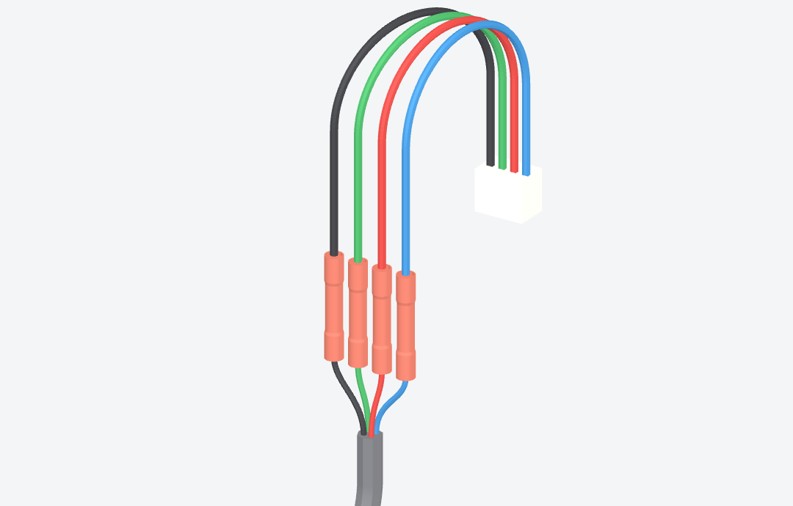

# TE320559 manufacturer CAD correction

The former J2 splice models were plain 5 mm cylinders. All four now use the manufacturer's C-320559 AE STEP with its bore and waist, translated without scaling. Its nominal diameter is 5.6134 mm and length 32.131 mm (1.265 in, rounded to 32.13 mm in the drawing). Factory conductor endpoints move 0.001 mm to meet the exact nominal CAD end. Pigtail routing and 170/170/170/165 mm proposed cut lengths are unchanged.

The current TE customer drawing C-320559 Rev V6, dated 16 September 2025, and AE STEP are archived in [TE-320559-drawing.zip](../engineering/mechanical/TE-320559-drawing.zip), with file hashes and dimensional provenance in [splice-evidence.json](../engineering/mechanical/splice-evidence.json). The prior V2 drawing remains in the archive for traceability.

Both renders use the same camera and harness positions. They show the actual generated GLB geometry. The automatic geometry regression checks every splice against the archived STEP, and the conservative harness-clearance check uses its larger radius. These checks do not establish finished-crimp tolerances, tooling, pull strength, delivered motor-wire insulation fit or physical strain relief. The board's four mounting holes, PCB copper, component placement and firmware are unchanged.
