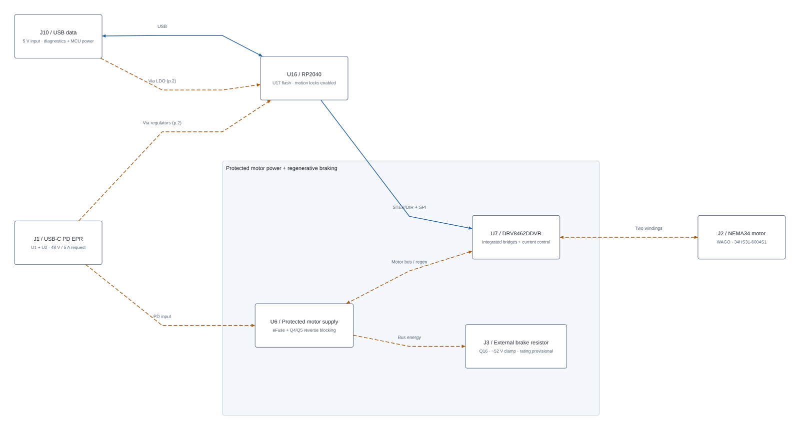

# NEMA34 system overview

Start with [the complete system](system-blocks/system-overview.svg), then open
[power domains](system-blocks/logic-power.svg),
[hardware protection](system-blocks/protection.svg), and
[control and telemetry](system-blocks/control-telemetry.svg).
Blue arrows are signals; dashed orange arrows are power. Two arrowheads indicate
two-way communication or returned motor energy, not two separate supplies.

The four pages answer four review questions, in order:

| Page | Review question |
| --- | --- |
| 1. Start here: power and motion | Where do power and commands enter, and where do motor/brake energy go? |
| 2. What powers each circuit | Why are there three bucks, an LDO and supply-selection devices? What works with DATA alone or after PD loss? |
| 3. What allows or stops motion | What must be true before input power and motor drive are enabled? How does the independent brake respond? |
| 4. What the controller reads and controls | Which chip measures raw PD voltage, protected voltage, current and temperature? What does RP2040 control? |

Start with the seven functional blocks on page 1. Follow the PD input to the
protected motor supply and driver, then the separate controller and brake paths.
The power-stage group follows the PD-to-motor path, with the controller above
and the brake on a separate branch. The telemetry page puts RP2040 between
sensors and outputs, following the chart style of the reviewer's RVboy example. These are
explanatory boundaries, not galvanic-isolation or physical PCB boundaries.
Component references connect the overview to the detailed schematic. `PD_READY`
is firmware-derived; the physical eFuse `MOTOR_PG` is a different signal.

## How the board operates

1. J1 receives USB-C PD power. U1 protects CC and U2 negotiates the configured
   48 V / 5 A EPR contract using U3's EEPROM image. U5 can power logic before
   motor power is enabled. J10 provides separate USB data and optional MCU power.
2. RP2040 checks the PD contract and configuration, raw input voltage from U38,
   temperature, fresh telemetry and fault inputs before requesting motor power. PD_READY
   is a firmware decision; it is not the same signal as the eFuse's MOTOR_PG.
3. U4 requires both PD_PATH_OK and POWER_PERMIT before enabling U6. The separate
   U10/U11/U33 chain requires MCU_RUN, MOTOR_PG, VMOTOR_OK and TEMP_OK to enable
   the motor driver. After motor power comes up, firmware additionally requires
   valid protected-bus voltage, driver readiness and brake preflight before
   asserting MCU_RUN. Reset defaults disable motion.
4. U7 regulates winding current using its integrated H-bridges. RP2040 supplies
   STEP/DIR and SPI configuration. J2's four WAGO poles connect to the two motor
   windings. The motor's 6 A/phase label is not an approved operating setting.
5. Deceleration or an externally driven motor can return energy to VMOTOR.
   U13 switches the independent Q16 brake near 52 V; J3's external resistor
   dissipates the energy. U22 backs the control rail from VMOTOR and U34 provides
   12 V brake-gate power during PD loss. The 10 ohm / 300 W resistor and cooling
   remain provisional.

DATA alone can boot RP2040 and its flash for diagnostics. It cannot power the
motor or the board's sensors. U18 is an optional, unpopulated encoder, with no
qualified magnet mounting or closed-loop motion claim. See
[the IC-purpose table and power states](usb-pd-architecture.md) for details.

## View and regenerate

The default routed `release/circuit.json` contains the four native
`system_block_page` records plus their blocks, routes and actual PCB-component
associations. Use the **System** tab and page selector in a supporting viewer.
On tscircuit.com it appears immediately after **Files**, but only when the
selected release contains the diagrams. While PR #25 is open, select its PR
preview version rather than the default main release.
Local preview: `bun run dev:system`. The SVG links above remain usable even if a
website deployment has not yet enabled its System tab.

`bun run build:pcb` rebuilds current source and the assembly, adds the diagrams,
checks the existing native-route fingerprint/DRC, and refreshes the default
viewer. Commit the refreshed generated files with source edits: a hosted rebuild
of an old committed `release/circuit.json` cannot update its schematic or diagram.
Run `bun run check:system` to reject missing/stale diagram metadata.

Authoring uses the official [system-block API](https://github.com/tscircuit/docs/pull/980)
in `system-overview.tsx`. The board stays on core 0.0.2112 and schematic-symbols
0.0.248; only the diagram layout uses the separately pinned core 0.0.2268 and
SVG renderer 0.0.455. The full-core upgrade experiment changed 908 solder-paste
records to 876 and changed schematic output, so it was not adopted for this
documentation change. CLI 0.0.3084 supports the newer viewer while the compatible
board compiler remains pinned.

The diagram generator seeds only existing source/PCB component identities into
the isolated renderer and appends only `system_block_*` records. It does not
generate replacement footprints or electrical connections. Tests reject missing
or ambiguous component links and prove all non-system records are preserved.

The pages use the native core's graph layout and `systemblock.group` boundaries.
Short node labels identify each function and its ICs; arrows carry power or
interface names. The overview follows the motor-power flow, the control page
centres on RP2040, and the independent brake stays separate from the enable
logic. Detailed operating conditions are described above and in the linked
architecture document instead of filling the diagram with text.

No fixed grid, manual coordinates or post-render geometry overrides are applied.
The same native layout is used in the live System tab and exported SVGs. All four
pages were visually reviewed for readable labels, grouping and unobstructed
connections.

This is a review aid. Existing USB hole-clearance findings, sourcing and physical
qualification holds remain; firmware motion locks are still enabled.
