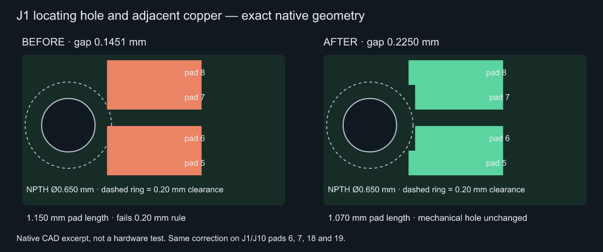

# USB locating-hole clearance

This revision removes eight genuine copper-to-NPTH clearance violations: J1/J10 pads 6, 7, 18 and 19. It does not change connector part number, pin/net mapping, placement, shell stakes, locating holes or the four board mounting holes.

The compiled/website Circuit JSON already specified `min_trace_to_hole_edge_clearance: 0.20`. The shared converter exported that value correctly. The native pipeline instead overwrote it with 0.13 mm in `export-kicad-route.mjs` and `clean-silkscreen.py`. Native DRC passing under that override did not establish compliance with the intended 0.20 mm rule.

## Geometry and manufacturing basis

[JLCPCB's NPTH guidance](https://jlcpcb.com/blog/npth-design-guide) recommends 0.20–0.30 mm copper clearance. This design enforces 0.20 mm consistently in TSX, compiled JSON, board policy and native project settings. Copper-to-hole distance is distinct from hole-to-hole spacing, track width and copper-to-board-edge clearance.

The [GCT USB4105 drawing, revision B4](https://gct.co/files/drawings/usb4105.pdf) specifies two 0.65 mm locating holes at 5.78 mm spacing and a recommended 1.15 mm solder-land length. The existing imported geometry gave only 0.1451 mm at the nearest lands. This is a **custom land-pattern adjustment**, not an unchanged manufacturer-recommended footprint:

- Trim 0.08 mm from the hole-facing end of pads 6/7/18/19 on each port. Length changes from 1.1500104 to 1.0700104 mm; the centre moves 0.04 mm away from the hole.
- Preserve the 0.2999994 mm pad width, opposite solder edge, contact pitch, hole coordinates/diameters, shell lands and connector position. The affected pads retain about 93% of their original area.
- The nearest nominal copper-to-hole gap increases to about 0.225 mm, leaving about 0.025 mm above the encoded minimum. This is nominal CAD margin, not a complete worst-case manufacturing tolerance or solder-joint qualification.
- Match copper, mask and paste to the reviewed shortened pads. Do not reduce or relocate mechanical holes to obtain a DRC pass.

The selected USB4105-GF-A-060 remains subject to assembler DFM and first-article solder-joint/retention acceptance. The connector's rated current is not qualification of the modified PCB land pattern. Existing motion and order holds remain in force.

## Reproduction and regression

The baseline is main `1b8b63f`. Copy the new `scripts/usb-hole-clearance.test.mjs` onto that baseline and run `bun test scripts/usb-hole-clearance.test.mjs`: the actual imported footprint reports **0.1450646 mm < 0.20 mm**. The mechanical-hole control passes. No fabricated fixture geometry or altered converter is needed.

On this revision the footprint test passes. `source-design-policy.test.mjs` also rejects the former 0.13 mm native override and a weakened compiled rule. CI runs these checks before the stock-dependent review. `engineering/usb-hole-clearance.json` records the exact native before/after footprint hashes; the existing whole-board guard rejects any unrelated edit. The parallel motor-feed guard retains its original baseline and admits only this separately hash-locked USB revision.

Fresh KiCad 10.0.5 checks use zone refill and `--all-track-errors`:

| Output | Hole-clearance errors | Other errors | Warnings | Unconnected |
| --- | ---: | ---: | ---: | ---: |
| Baseline through captured website converter | 8 | 25 board-edge | 634 | 0 |
| Fixed circuit through the same converter | 0 | 25 board-edge | 634 | 0 |
| Same fixed export, with intended 0.20 mm edge rule restored in a local copy | 0 | 0 | 634 | 0 |
| Fixed native project with its intended rules | 0 | 0 | 401 | 0 |

The shared-export edge-rule loss is a separate issue: its missing setting invokes KiCad's 0.50 mm default. Earlier runs without `--all-track-errors` reported 17 edge errors; the expanded run reports 25 on both baseline and fixed geometry. No hole rule was relaxed for the control. The converter check uses its captured deployed bundle locally; it is not a fresh website download of this unmerged revision. Native schematic parity and ERC both pass; schematic parity was not run on the converter-only output.

All 401 native cosmetic warnings remain visible. Full source connectivity and all 3,023 schematic records remain unchanged. All 18 motor/supply/shunt/brake DC paths were re-solved at two meshes, with two finer refinements (38 solves total); convergence and resistance-regression checks pass. J1 VBUS to Q4 is 13.4843 mΩ at the 0.05 mm mesh, excluding connector/contact losses. See `engineering/usb-hole-clearance.json` for exact measurements, raw baseline hole findings, converter hashes and result counts, and `engineering/copper-geometry-review.json` for the analytical results. These checks do not imply hardware qualification.
