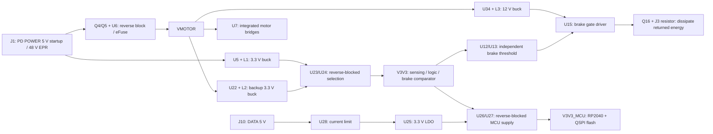

# Power architecture and component review

Current design: RP2040, DRV8462DDVR, TPS26750, WAGO J2/J3, optional AS5600. This document replaces the obsolete STM32/TMC5160 description. The nine source schematic pages follow the signal and power paths below. Native electrical checks and physical qualification remain separate.

## Reference-board decision

The public sources retrieved on 2026-11-03 do **not** all use DATA-only MCU power:

| Reference | Observed MCU power path |
|---|---|
| [NEMA23 v1.4.7](https://tscircuit.com/imrishabh18/nema-23-stepper-controller) | `VFUSED -> U_PD_LOGIC AP63205 -> PD_LOGIC_5V -> D_PD_LOGIC -> VSYS`; the existing DATA diode also feeds VSYS. PWR or DATA can power logic. |
| [NEMA17 v1.0.48](https://tscircuit.com/imrishabh18/rp2040-motor-controller) | DATA powers the MCU. The published README explicitly requires DATA power for the PD-voltage alarm. |
| [NEMA14 RP2040 v1.13.2](https://tscircuit.com/AnasSarkiz/NEMA14_RP2040) | `PD_VBUS -> D_PD -> LOGIC_IN` and `DATA_VBUS -> D_DATA -> LOGIC_IN`; U_BUCK supplies V3V3. Both sources are supported. |

The user's request to follow the reference boards is implemented as **retaining the NEMA23/NEMA14 dual-source behaviour**, not silently removing standalone operation. Our dedicated J1 remains POWER-only: NEMA23's newer USB data mux is not a requirement for this board. The references' lower-voltage regulators and motor-current ratings cannot be copied onto a 48 V / 6 A-phase motor design. Exact release IDs and selected source hashes are in `engineering/reviewer-power-reference.json`.

## Supplies and what each one powers

U5, U22 and U34 are **LMR36510 step-down bucks**, not buck-boost converters. U25 is an LDO; U23/U24/U26/U27 are ideal-diode devices, not voltage converters. J1 and J10 VBUS are never joined. U34 powers the **brake** gate driver, not DRV8462, which has its own charge pump.

| State | Intended electrical behaviour; bench verification still required |
|---|---|
| DATA only | RP2040 and its flash boot for USB recovery/diagnostics. Board sensors, motor and brake rails are off. GPIO/buses must not back-power them. |
| PD only | U5 powers board logic and MCU. TPS26750 must report a valid configured EPR contract before firmware can request motor power. USB must not attach without DATA VBUS. Local START/STOP is supported only after qualification locks are legitimately cleared. |
| PD and DATA | Reverse-blocked selection prevents one input feeding the other. Supply handover/inrush and USB current require measurement. |
| PD removed while motor bus is charged or regenerating | U22 maintains comparator/control power from VMOTOR; U34 maintains brake gate power. The motor is inhibited, while the independent brake can dissipate energy. Backup availability and transient timing are not yet hardware-proven. |

Removing U22 without another motor-bus-powered brake-control path can disable the comparator while returned energy remains. Removing U34 disables the present Q16 gate-drive solution. A shared converter or a different brake switch is a separate power/thermal redesign, not a safe deletion to reduce a chip count.

## Driver variant decision

[TI DRV8462](https://www.ti.com/lit/ds/symlink/drv8462.pdf) specifies DDW at 5 A full-scale / 3.5 A RMS and DDV at 10 A full-scale / 7 A RMS, subject to thermal design. DDW has its exposed thermal pad underneath; DDV has it on top, and the pin maps differ. They are not interchangeable on this PCB.

Retain **DRV8462DDVR** for the ordered 34HS31-6004S1 motor's 6 A/phase target. A cheaper DDWR could operate the motor at reduced current, but does not preserve that target. Neither the motor's phase label nor DDV's headline rating establishes an approved operating RMS current. Firmware remains locked at the restricted commissioning configuration; see [thermal qualification](thermal-qualification.md). No supplier screenshot is treated as a current price/stock reservation.

## Every IC's purpose

| Ref | Device | Purpose and reason for retention |
|---|---|---|
| U1 | TPD4S480 | USB-C CC short-to-VBUS protection and EPR front-end control. Unused system-side SBU pins grounded as reviewed. |
| U2 | TPS26750 | Sink-only 48 V / 5 A EPR negotiation and power-path command; needs the verified U3 configuration. |
| U3 | M24512 | 64 KiB PD boot/configuration EEPROM; independent of MCU flash. |
| U4 | SN74LVC1G08 | AND of PD_PATH_OK and MCU POWER_PERMIT; prevents eFuse enable from either alone. |
| U5 | LMR36510 | PD input to 3.3 V, before the eFuse, so logic can boot before motor power is enabled. |
| U6 | TPS26630 | Input current limiting, undervoltage/overvoltage protection, fault latch and power-good indication. |
| U7 | DRV8462DDVR | Integrated dual H-bridge, current regulation, STEP/DIR and SPI; top cooling remains unqualified. |
| U10 | SN74LVC1G08 | MCU_RUN AND physical MOTOR_PG. |
| U11 | SN74LVC1G08 | Adds independent VMOTOR_OK to the enable chain. |
| U12 | REF3425 | Stable 2.5 V reference for the brake and overvoltage comparators. |
| U13 | TLV3201 | Independent brake turn-on comparator near 52 V; works without a firmware brake command. |
| U14 | TLV3201 | Independent motor-overvoltage inhibit near 53.21 V. |
| U15 | UCC27511 | Drives Q16's gate from BRAKE_12V for controlled resistor switching. |
| U16 | RP2040 | USB diagnostics, STEP/DIR, SPI setup and supervision; firmware qualification locks retained. |
| U17 | W25Q32JV, 4 MiB | RP2040 QSPI boot/program storage, powered on the MCU rail. |
| U18 | AS5600, DNP | Optional magnetic-angle telemetry. No validated rear magnet and no closed-loop motion claim. |
| U22 | LMR36510 | VMOTOR-derived 3.3 V backup for brake/control during PD loss. |
| U23 | LM66100 | Reverse-blocked PD-derived board-logic supply path. |
| U24 | LM66100 | Reverse-blocked motor-backup logic path; interlocked with U23. |
| U25 | TLV75533 | DATA-port 5 V to independent MCU 3.3 V. |
| U26 | LM66100 | Board supply path into the MCU rail, with reverse blocking. |
| U27 | LM66100 | DATA-derived supply path into the MCU rail, with reverse blocking. |
| U28 | TPS2553 | DATA-port overload current limiting; not a substitute for USB enumeration/suspend current compliance. |
| U29 | TMP102 | Board-temperature telemetry and TEMP_OK hardware inhibit. Board temperature is not driver junction temperature. |
| U30 | ADS1115 | Protected VMOTOR, input-current-monitor and brake-return ADC channels. |
| U31 | INA240A1 | Phase-A inline-shunt diagnostic amplifier. |
| U32 | INA240A1 | Phase-B inline-shunt diagnostic amplifier. Neither channel is the driver's current regulator. |
| U33 | SN74LVC1G08 | Adds TEMP_OK to RUN_WINDOW_OK, producing active-high RUN_SAFE. |
| U34 | LMR36510 | VMOTOR to 12 V for brake gate driver U15. Not a legacy external motor-bridge supply. |
| U35 | PCA9538 | I2C RGB and buzzer outputs. Hardware protection does not depend on the indicator bus. |
| U36 | SN74LVC2G66 | Isolates the PD controller's EEPROM bus for fixture programming. |
| U37 | SN74LVC1G17 | Reset-domain buffer for U35; protects the independent supply/reset relationship. |
| U38 | INA237 | Raw PD_VBUS ADC before the eFuse; 85 V bus capability, separate from VMOTOR measurement. |

## Enable equations and default states

`EFUSE_EN = PD_PATH_OK AND POWER_PERMIT`

`RUN_SAFE = MCU_RUN AND MOTOR_PG AND VMOTOR_OK AND TEMP_OK`

U4 is an input-power permission gate; U10/U11/U33 gate the motor driver. They are not four copies of the same function. Pull-downs hold the driver disabled and the permit inactive during reset. MCU fault handling remains additional to the hardware inhibit path. Consolidating gates into one package is possible only after checking placement, power domains, fault behaviour and rerouting; deleting gates or relying solely on software is not this review's solution.

PD_READY is a **derived firmware status**: fresh U38 conversion plus a live configured APP/sink/EPR 48 V / 5 A contract. MOTOR_PG is a separate physical eFuse signal. Stale ADC, sensor loss, invalid configuration, supply faults or an uncleared qualification gate prevent motion.

## Review and validation limits

Read the source-generated `release/schematics/*.svg` pages in order, with the component table and the two enable equations. The paired native KiCad schematic is currently a verification artifact: `normalize-kicad-parity.mjs` snaps its pin coordinates and assigns hidden net labels for parity/ERC. Use the visible source schematics for human circuit review; a zero-error native verification artifact is not proof of drawing readability. The topology, board placement, footprint/pin identities, copper and protection thresholds are preserved by this schematic cleanup. The source/native comparison must prove that statement; a style-analysis pass alone does not prove human readability.

The eight known USB hole-clearance errors, cosmetic findings, unresolved sourcing, rear fastening, thermal/brake limits, actual programming/readback and powered tests remain visible. A readable schematic and a successful DRC run do not qualify the assembly.
